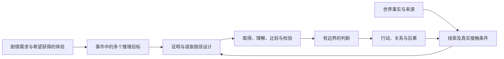

# 推理目标与线索分布设计通用能力

2026-10-17空间增量：[第5.5节](#optional-late-clues)补可选隐线与迟现材料，实际范围见[空间记录](../audit/46-spatial-design/00-integration.md)。同日1.5的时序／物态修订保持原样，两项增量分别登记验证。

技能参考版：1.5，2026-10-17。补充线索组合的比较记录、物态候选与陈述范围；时序桥段的双轴呈现与接力操作归[专项方法](embedded-investigation.md#时间轴与分段见闻)。实际更新及验证范围见[45记录](../audit/45-timeline-evidence-integration/00-integration.md)，不据此重授旧正文全篇或真人资格。

旧局部版本记录：1.4，2026-10-13。局部同步通用稿v0.7的三类赋能及相关调用、卡表和审核接口，实际集成见[41记录](../audit/41-inference-empowerment/00-integration.md)。在本副本原文上增改，既有迁移差异保留，不授旧正文全篇重验或真人资格。

旧版本记录（仅保留原对象）：技能参考版：1.3，2026-10-11。合入已获用户采用的事实覆盖、专属目标阶段、玩家取证口径、命题／入口和游戏进度接口；实际迁移及受影响版本验收见[本轮记录](../audit/39-inference-refinement/00-integration.md)。保留旧版本验证对象，用于固定幕后事实的调查型TRPG及互动悬疑；共同生成真相的玩法需另订方法。本文本与纸面验证不代表真人桌测。


按任务读取：目标与证明见第2—3节；认知阶段见第4节；线索卡见第5节；推理回报及投放见第6—7节；调用及运行见第8节；模板见第9节；完整有限事件见第10节；反例见第11节。局部诊断不必填写全部模板。

**职责与编号：**本页维护推理目标、事件／单目标认知、多轴线索、充分组合、体验路径及投放模板的详细定义；[调查](investigation.md)保留调查总览与七类联系的定义。本页`R0—R5`均为认知状态，在与七类联系共用的表中写为`Stage.R0—Stage.R5`；七类中的`R1—R3`写为`Link.R1—Link.R3`。`Stage.R4-J`是有界确认，`Stage.R4-U`是明确未决；未决不是已证实。两类编号互不继承、不新增联系类别。纯七类联系任务无需加载本页。

## 1. 已有理论能支持到哪里

最接近完整设计骨架的是Justin Alexander的揭晓清单、三线索法则和节点式调查。可以从这些已有方法开始，再用探究与证据分析完善单目标进程，用游戏体验设计约束线索安排。下表区分原方法和本稿的转译，不声称存在一套现成的“五部分统一理论”。

| 现有理论／方法 | 支持本稿的部分 | 使用边界 |
|---|---|---|
| [Revelation Lists](https://thealexandrian.net/wordpress/40978/roleplaying-games/random-gm-tip-using-revelation-lists) | 先列希望玩家形成的结论，再配置取得信息；区别线索接触与结论形成 | 本稿增加剧情用途、竞争解释、证据限度和双层状态；不是逐字照搬 |
| [Three Clue Rule](https://thealexandrian.net/wordpress/1118/roleplaying-games/three-clue-rule) | 防遗漏、误读、取得失败造成的调查瓶颈 | 原作者强烈主张至少三条；本稿取其容错思想，不把三条当逻辑充分性或普适配额 |
| [Node-Based Scenario Design](https://www.thealexandrian.net/creations/misc/node-design/node-design2.html) | 用地点、人物、事件等调查节点和连接支持不同顺序、多路径 | 节点可达图不等于证明依赖图；能去下一处不等于已经推对 |
| [GUMSHOE：Clues vs. Leads](https://pelgranepress.com/2020/02/21/clues-vs-leads/) | 区分引路、推进必需信息和理解内容，减少取得关口 | 其规则是系统内机制；在COC中迁移设计原则须另核规则，不自动照搬取得方式 |
| [Dewey：How We Think，第六章](https://www.gutenberg.org/cache/epub/37423/pg37423-images.html) | 从困难、问题、假设、推导到观察检验的探究循环 | 本稿状态是设计与观察工具，不是所有人的心理时间表 |
| 竞争假设分析与逻辑推理 | 将同一材料置于不同解释下比较，查诊断力、缺证及边界 | 详见[目标与认知阶段研究](../audit/inference/research/2026-10-10_线索分布理论_目标与认知阶段.md)；不把实务分析方法当事实必真算法 |
| [Golman与Loewenstein：Information Gaps](https://www.cmu.edu/dietrich/sds/docs/loewenstein/Information%20Gaps%20published%20version.pdf) | 用已意识到的问题组织未知、注意与继续获取信息的动机 | 支持明确问题的设计取向；不保证每个玩家必好奇或必采取同一行动 |
| [MDA](https://www.cs.northwestern.edu/~hunicke/pubs/MDA.pdf)与洞察研究 | 从预期体验反推玩法和反馈，区分“想通的感觉”与解答质量 | 爽感类型及投放矩阵是本稿综合，不能凭理论宣称游戏实测有效 |

研究按原著、原作者设计文、官方规则说明及原始研究整理。完整出处、实际读取范围和迁移限度分存[研究入口](../audit/inference/README.md)。技能提供审读流程和公平回报检查，不能作为学术实证。

### 1.1 五部分是否足以构成整个基础

五部分能够组织推理设计的主体：要理解什么、怎样逐步理解、凭哪些信息、亲手推理有什么回报，以及怎样安排接触机会。它们是相互连接的设计维度，不是五个独立工序。要作为可运行调查剧本的推理基础，还须明确下列横贯条件；它们沿原阶段使用，不新增四个开发阶段。

| 必须交代的条件 | 它为什么不能省略 | 相关方法与补足接口 |
|---|---|---|
| 世界规则与玩家可用知识 | 作者知道的规则或专业常识若玩家无合法入口，材料再多也可能推不出；目标成立还依赖对象、时间和规则范围 | 第2.1、3.3节及模板登记前置知识、适用范围与真实入口 |
| 目标的证明结构与可解性 | 一堆线索可能只有支持、无法区分竞争解释；目标之间的连接也不能靠累计答对代替 | 第3.3—3.4、6.1节及负证据条件核充分性，并给完整OR路径例 |
| 玩家主动调查与世界反馈 | 玩家会提出作者没列的查法；世界、角色与材料要按其真实条件回应，并允许认识先用于有限行动 | 第8.1节核预设外查证及轻量运行循环，联查移动、可达与真实后果 |
| 呈现、容错与验证 | 字面不清、专业解读缺失、材料未分享、骰点失败和提前识破会改变实际可推范围；文本自洽不等玩家会读懂 | 第8.1及11节区分阻点诊断与证据、呈现、运行、体验验证 |

因此，本稿的判断是“五部分可作为主干，配以上述条件组成可制作的工作框架”。这不证明它穷尽所有推理玩法。相对固定事实调查的采用范围，主干外的历史、空间、NPC基础事实和规则仍由对应阶段提供；本能力负责检查接口够不够，而非另写一套世界。

### 1.2 迁移、融合、游戏特化与需求扩展分别在哪里

下列标签说明本稿如何形成，可重叠：**保留**为采用原方法的核心做法；**融合**为将不同方法重组为共同对象与接口；**游戏适配**为按互动调查、角色限知、规则和玩家选择改变用法；**需求扩展**为响应用户五项和当前开发约束而增加字段或关系。不使用这些标签宣称全球首次提出或已经实证验证。

| 具体设计 | 归属及实际变化 |
|---|---|
| 按预期结论配置线索、检查调查出口 | 保留揭晓清单与节点法的核心；原方法本身已经服务游戏，不能把其游戏性都记为本稿新增 |
| 取得冗余与独立证明分开 | 融合三线索容错、来源依赖与证明组合；取“三条”背后的容错用途，另核各充分组合，不直接套固定配额 |
| 从剧情用途拆行为、目的、关系和操作目标 | 在预期结论上融合故事需求、证明边界与行动门槛；按用户要求扩展目标组合和剧情接口 |
| 事件整合与单目标R0—R5双层记录 | 融合探究循环与用户阶段想法；六工作状态、J/U和事件整合卡是本稿组织方案，允许跳层与回退 |
| 一手/二手、载体真伪、陈述准确性、可靠性、功能分轴 | 融合来源分析及线索功能；适配NPC误记、真载体载谎、布置现场与玩家重新解释，回应用户的欺骗与功能需求 |
| 目标状态×信息作用×提供方式矩阵 | 融合认知进程、线索功能与互动取得；矩阵是本稿综合，不是Dewey或GUMSHOE原表 |
| 固定物证不任意浮动、秘密不自动共享、可取消结果持续有效 | 调查游戏适配，其中固定事实、取消和来源边界受当前项目约束；不同玩法可另订边界，不冒称原GUMSHOE禁令 |
| 材料已够就认可提前判断、失去必要事实仍可有限行动 | 把证据标准、玩家主动性和事件后果结合；接触顺序不代替因果，不保证每桌经历同一反转 |
| 玩家前置知识、非预设查法和停滞诊断 | 需求扩展：“作者能解与玩家能解”的知识接口及真实调查响应；支持依据与转译范围见专题研究 |

游戏特化贯穿五部分：目标要产生真实选择，阶段允许乱序，线索受人物与世界约束，体验落实为可做的认识操作，投放回应玩家行动。第6节负责明确预期回报；其余各节共同提供产生回报的条件。

## 2. 基本对象与关系

**世界事实**：故事中实际发生或当前成立的状态，独立于玩家发现。**载体**：承载信息的物、身体、环境、记录、行为或人。**线索**：玩家在实际接触中可获得的信息片段，能够引出问题、改变某个判断、指向调查机会或支持行动。载体与线索不一一对应：一份信可以有几个信息片段，几个人也可能只重复同一来源。

**推理目标**：玩家需要或可以回答的明确问题及其可检验判断，如“伤害发生在操作之前还是之后”“甲是否得到乙的授权”。目标包含候选解释、判断范围、所需依据和剧情用途，不等于一句供KP知道的秘密。

**事件真相**：多个目标相接后，对该事件中发生什么、怎样发生、谁参与、影响谁及为什么的有边界解释。**剧情推动点**：一项认识或行动使机会、危险、关系、资源、立场或结果改变的接口。目标可以支持推动，也可以服务人物理解、情绪回收或可选探索，不强制所有认识立刻开门。

赋能设计、制作或审查先读[第6.3节](#inference-empowerment)，分别写内容、体验和用途；情绪／求知可有其他价值，但未落实三类作用时不冒记赋能完成。

本方法维护三种关系：目标之间的证明依赖；调查节点之间的接触路径；目标与剧情后果之间的用途。三者共用ID，但分别画清。



### 2.1 玩家前置知识与推论规则的可用性

**推论规则**是从材料到判断所需的关系，例如某类操作会留下何种痕迹、某日期格式怎样理解、某种异常只在什么条件下发生。它可能来自常识、角色专业能力、先前体验或局内新查证。作者须登记它对当前目标的适用范围与玩家实际获得入口，不能因作者知道就视为玩家已有。

可沿现有目标卡登记：玩家/角色开局知道什么；哪个必要概念或规则尚未知；由谁通过观察、说明、示范或真实反馈提供；何时可获得；可靠范围和例外。角色有专业技能但玩家缺专业知识时，按所用规则把角色有资格判断的内容转为明确可用信息；可给有限专业解释，不替玩家串出超出专业范围的全部因果。玩家的现实专长也不能自动覆盖角色无法观察或获取的局内事实。

首次呈现须分清观察、来源说法和解释，让关键对象、时间、位置及比较字段能被辨认或有合法辨认入口。可以保留身份未知、模糊表象和需要解读的材料，但不能把作者内部ID当玩家理解，也不能将无提示的生僻知识设为唯一过关口。难度可来自联系、比较和检验；获得前置知识的过程本身也可设计为目标。

这是把学习与证据研究用于游戏制作的接口，不是要求玩家统一受训或进行知识考试。相关原资料及适用边界见[逻辑研究](../audit/inference/research/2026-10-10_线索分布理论_完整性与扩展_逻辑席.md)。

## 3. 第一部分：从剧情需求构建推理目标

### 3.1 先确定事件需要带来什么

先写这个事件的剧情作用：它要引出危险、改变信任、纠正责任、打开调查方向、提供行动方法，还是使玩家面对取舍？再写玩家应该亲手完成哪次认知变化。没有这一步，目标会变成穷尽后台知识的题库。

先从当前采用的事件、人物与关系资料列出重要事实，检查经过与时序、参与行为、个人处境与经历、关系与知情，以及当前选择的前件和后果。重要性由遗漏会损失哪种理解、选择、情绪回收或运行依据判断，不以秘密数量衡量。每项事实注明处理去向：推理判断、有限直接获知、背景、运行条件、披露待制作或有意保留未知；去向可重叠，不能用“已覆盖”代替范围。实际观察、人物答复或文书已明示的，按来源范围记获知，陈述准确性和历史确认仍另核。

推理目标是玩家需要形成的判断，说明比较、排除、连接或检验什么。“救出伤者”“完成支线”“让人物认罪”是行动或剧情结果，不直接等于推理目标。人物事实可服务理解及情绪回收，不必都成为主谜底证据，也不为每项背景另建谜题。

从事件真实因果拆问题，可使用下列类别检查遗漏，按需要选取，不按数量凑齐：

| 目标类别 | 常见问题 | 不能自动连带证明 |
|---|---|---|
| 状态与身份 | 是什么，是否同一人／物，曾在何处 | 同身份不证行为或动机 |
| 时间与顺序 | 哪一步先发生，持续多久，是否同一次 | 时间邻近不证因果 |
| 行为与行动者 | 谁做了什么，实际做到哪一步 | 接触、能力、机会不等实施 |
| 因果与机制 | 什么产生什么，何种条件使它成立 | 相伴发生不等唯一原因 |
| 关系与协作 | 谁授权、依赖、知情、承诺、帮助或阻碍谁 | 关系不自动共享知识或同谋 |
| 目的与责任 | 为什么这样做，有无替代与明知，承担哪项责任 | 做了不等恶意；有动机不等做过 |
| 风险与操作 | 怎样识别危险、停止、返回或改变结果 | 知道历史不等掌握完整操作 |

关系目标尽量写为“甲在何时向乙承诺什么，乙是否据此行动”，不要只写“甲乙关系好”。行为、知情、选择和目的分别证明；道德评价和法律式归责不从单个事实自动推出。

### 3.2 决定哪些目标合并，哪些拆开

若两个问题依赖不同来源、能处于不同确定程度，或会产生不同选择，就应分开。若几个细节共用同一判断、无法提供独立体验或行动价值，则作为目标字段而非新目标。一个事件需要几个目标，取决于剧情承诺与因果复杂度，不预定三至五个。

例如“甲偷走东西并故意陷害乙”至少要分别看物件确曾被移动、甲实施搬移、是否具有盗取目的、另一次栽赃是谁实施；搬走物件者可能实际在保护它，而栽赃者另有其人。身份或一个脚印不替这组问题全作答。

### 3.3 为每个目标登记完成标准

填写明确问题、承接的事件／个人／关系事实及故事线、作者事实、候选解释、判定范围、需要说明的假设、最小充分信息组合、反驳或降级条件、不可推出的结论，以及具体剧情／游玩用途。区分：

- 能引起合理怀疑。
- 能使某解释较优，但仍有重要缺口。
- 能在声明前提与范围内作稳定判断。
- 已足以支持保护、暂停等行动，但尚不足定完整责任。

“足以采取行动”的门槛与“足以断定历史”的门槛不同；它们不能用一个解题进度条代替。行动风险越高，所需把握通常应另核，不能普遍规定百分比。

判定玩家可解时，把实际能取得的材料与第2.1节可用规则一起核；不能只凭作者完整后台作出推论。若必要规则未提供，登记缺口及入口；若规则本身可争议，先作为待核前提而非确定事实。

直接看见结果、读到记录或听到明确自承，先记录实际获知及来源范围；经对象对合、时序关联、候选比较或范围检验形成新的有界关系，才记相应推理完成。行动成果另记。明确知道还缺什么可以是进展，但未决不当已证实，推理回报也不要求玩家说服NPC或选择作者偏好的结局。

### 3.4 建立目标组合与剧情接口

使用AND／OR依赖记录：某结论需几个不同事实相接为AND；足以支持同一范围的不同组合为OR。OR每个分支都须独立满足同一目标的完成标准，不能仅因来源不同就视为充分替代；其中一条分支也可包含多个AND前件。同源转述可形成取得上的OR，但不自动成为证明上的独立AND。一个线索可服务多目标，必须检查累计效果，防单条普通线索意外交出全案。

最小充分组合（旧称最低充分集）是相对明确目标、前提与完成标准而言的充分组合：移去其中一个必要成员即不再足够。这里的最小是包含关系，不要求在不同方案中条数最少。可以存在多组，不要求所有桌使用同一组。它不是线索数量配额。知识规则、范围与来源资格也是组合的前提，删项检查时不能悄悄补入作者知识。

完整替代路径的短例：目标仅为“同一原稿在t1到t2之间离开展位”，在身份、时间和观察可信的声明范围内，`[(t1真在展位 AND t2同一原稿真在柜中 AND 对象/时序对合) OR (对搬移过程的可靠连续观察 AND 原稿身份核验 AND 起终位置/时序核验)]`。任一完整分支可支持同一位置变化；只剩“柜里有一份相似稿”或“有人说好像搬过”不构成充分分支。此例展示一个独立可能设计，不给调用任务新增目击者，也不证明谁搬或为何。

跨目标或跨故事线整合，注明实际成立的时间、身份、因果、知情等连接。共用命题不自动共用结论；仅为查阅并列的联系不强做成证明依赖。目标来源池只是候选检索，不是充分证明或集齐门票；关系的支持与阶段用途须落到本次具体信息，不从整条线索的编号继承。

事件整合条件采用“目标及它们的因果连接”，不采用“答对若干个”。证明演员、动作和时间后仍可能缺动作间的关联。需要整体理解时，注明是哪几个结论及哪条连接足够；其他背景可保未知。事件推动可先于全貌，例如怀疑有人阻救已足以安排保护。

## 4. 第二部分：事件与单目标的两层认知进程

### 4.1 事件整体进程

事件层描述玩家目前把哪些问题组织成了一件事，可用以下工作状态：接触尚未成组的信息；意识到值得调查的事件；建立问题与目标关系；形成局部因果模型；比较修正并连接多个目标；取得足以支持剧情选择的事件解释；深化全貌或带缺口收束。

这些状态可能并行、跳过或折返。玩家可能开场就听到死亡结局，却仍不知道身份对应与经过；可能知道犯人却还在查关系；也可能已决定离开但保留动机未知。“全貌”只指项目声明范围内的模型足够连贯，不指穷尽每个人全部内心。

### 4.2 单个推理目标进程

每个目标先写自己的必要认识变化，再借通用状态核对。阶段名称说明本目标实际比较，例如“发现记录对象可能不同—对合个体与时点—排除同批次即同人的解释”。每段记录当前知道／猜什么、还缺的可区分关系、怎样查及所用推理方法、成立后具体理解／选择／体验，以及完成依据与省并条件。简单关系可一次或少量比较成立，复杂目标可由已成立子判断整合，不重做子调查。

本稿用六种工作状态服务制作：

| 状态 | 玩家正在处理什么 | 设计需要提供什么 | KP可观察依据，不作答题口令 |
|---|---|---|---|
| R0 接触／潜伏 | 已接触碎片，但尚未将它视为这个问题 | 可记住的表象、关系或异常，后续可重新比对 | 实际看、听、取得；不记成已推理 |
| R1 问题化 | 指出未知、矛盾或需要区分的行为 | 问题边界、为什么重要、至少一个可查切口 | 问某事、比较差异、为核问题采取行动 |
| R2 候选解释 | 提出一个或多个可能说明，不必说出作者预设名单 | 支持某解释的片段和仍有疑点的事实 | 假设、备选或试探行动；不记成证实 |
| R3 比较／检验 | 查不同解释会预期出现什么，找区分它们的依据 | 高诊断力信息、可执行查证、来源核验和反证 | 对照、复访、实验、追问时序；也可一步跳到判断 |
| R4 作出有界判断 | 一个解释在已述前提和范围内足够稳定，或有依据明确当前不可判 | 充分组合、主要竞争解释处理、剩余限度 | 分记J有界确认与U明确未决；同时核材料是否真够 |
| R5 用途／重释 | 认识支持主动意图、行为判断或其他目标推断，亦可重释旧内容 | 按第6.3节提供相应接口；不要求先到R4或完成全部阶段 | 记录实际意图、选择依据、行为／不使用及新推断；重释不自动计赋能 |

R4-U只说明知道缺口及为何当前不能判，原目标仍未证实，不能在事件整合表当已确认目标计入。它可来自必要材料真实失去或主要解释仍不可区分，不等R2的随意猜测。R5不是“整个事件全解”，也不表示证明升级；未知或较优解释也可用于合理行动。直接明示可使问题R0→R4-J，但须记为直接获知而非自动取得推理成绩；有的目标长期停在R2仍允许行动；反证可R4→R2；新来源揭露伪造也可能重新定义问题。正常设计不要求每目标经历六步，不靠隐藏已取得字段阻止跳层。

### 4.3 分开实际相信与证据支持

逐目标至少分栏记录：已取得信息；玩家目前相信什么及主观把握；这些信息实际能支持到哪；当前采取什么行动。可以出现“玩家确信甲有罪，证据只支持甲曾到场”，也可以出现“材料足够，玩家仍犹豫”。这是误判设计与提示诊断所必需。

再按每名角色的实际取得与消息送达范围记录；共享以游戏内真实交流、共同取得或已约定且成立的共享机制为依据。玩家桌外讨论与共识另记为玩家模型，不能据此更新角色或NPC所知。一人私得未传仍只在其角色域；两人已收到同一原话，即使解释或意见不同，仍共有所听字段，各自判断另列。设计预期状态与实际桌上状态也分开，前者是投放规划，后者是观察结果。

事件状态由各目标的状态、证据限度及目标连接综合描述，不能按六目标平均R值生成。例如行为已稳定、目的仍假设、关系未知，是正常可用的事件状态。

## 5. 第三部分：线索的多轴定义与设计

### 5.1 来源距离、真实性、可靠性与证明力分别定义

**玩家来源距离**：以本次取得的具体命题和当前接收者为准。一手是玩家直接观察的痕迹、场景、物态或动作；二手是通过人物陈述、报告、文书或其他载体语义获知的事情。本人自承、目击者当面报告、玩家亲读原件仍属玩家二手；原知者是否亲历、亲闻、参与、转述或猜测，另记资格和形成链。本技能采用此取证口径，不宣称它是所有学科唯一术语。

玩家亲见纸边烧损是一手，纸上记载某人已转送是二手；亲见交物动作是一手，听人说以前交过是二手。握手动作不自动证明和解或共同目的。人际是渠道／关系属性，不是一手、二手之外的第三互斥类别；人物语义按二手处理，当场动作有独立意义时另列一手。原知者亲历不能复制成所有听者的一手资格。

**载体真实性与完整性**：是否真实原物、真实副本、伪造或局部改造，当前保留什么。**信息或陈述准确性**：某项观察描述、记载或话在何范围符合作者事实；可准确、真但片面、真诚误记、故意说假或暂不明。真原件可以载谎，伪造文件也可能有准确字段，两轴分别填写。**可靠性**：观察条件、记忆、记录保存、专业范围、传播损失、动机和被操控的可能。**诊断力**强调材料在竞争解释间的区分；**证明力**还要结合来源条件、前提、信息组合和未处理替代，看能支持或排除到哪。高诊断力不必单条充分。

一手没有天然真确保证，二手也不能只因间接而判不可信。间接传播增加要审查的环节；保存良好、明确范围的转述仍有用。多个二手来源可能都依赖一个原始人，不能伪装独立互证。不同作者也可能使用同一底稿或遭同一安排，来源独立须针对具体事实核。

来源质量、底层信息、分析假设与判断分开，可参考[ODNI分析标准原文D.6.e](https://www.dni.gov/files/documents/ICD/ICD-203.pdf)；本稿字段是游戏设计转译，非采用机构完整操作规范。同源副本可以对抄录完整、旧传播或删改史提供新价值，只是不能增加原事件的独立目击数。

### 5.1.1 从内容到线索字典

先写承接的事实、本次实际公开内容和怎样取得，再写性质标签。仅填“痕迹”“人际”“关键证据”不能构成线索稿。复杂条目可分三层：母条目整理同一对象；有限命题是本次能给玩家的一项具体信息；取得入口说明谁、何地、怎样行动及满足什么条件才得到哪些命题。记号和表数可自行选择，但不能把母条后台事实整包给出。

每项命题有具体内容、事实引用、玩家手别、原源／原知资格、形式、目标与阶段用途、能支持及不能证明范围；每个入口有地点或实际持者、行动、条件、本次提供范围、接收对象、不可取得反馈和真实下一方向。涉及传递时写渠道与确收条件；设计时记接收条件，运行才记实际确收。人物回答另核原知范围、愿答／拒答条件；文书另核当前可读内容、缺失怎样形成和移动／携带限制。真假、准确性、可靠性、区分力与证明力继续分轴。

入口的“甲或乙成立”只给当次成立分支的内容，不同时发甲、乙已完成。局部取得一般不以全链结果为门票：看烧后外观不要求试水完成，看到退出路让开不要求人已回安全区；局部事实也不证明整体结果，等待接班不是已交班。保留真实视野、许可、资源和因果前件，区分事件发生条件与观察条件，不为便于取证增造目击或万能文件。

本阶段可据已定事实写条件呈现及有限答复，注明是呈现稿而非原源逐字引语；未定历史、动机或物件不能借例句变事实。未写成内容不得伪装为褪字、缺页或人物拒答。

细分复杂母条时，原查询号可保留为聚合入口，并关联各人物、载体或物态子条；每个子条独立写本次内容及取得条件，聚合入口不新增一份证据。专项短号、正式条目号与原源号保留映射，来源范围按该短号实际使用的片段核，不继承聚合项全部人物的见闻。向玩家呈现时只取本桌实际取得的内容；KP查询全库不等角色全知。

### 5.2 欺骗与误导的发生层

| 层 | 设计情形 | 公平纠正入口 |
|---|---|---|
| 现场／载体 | 真脚印由人有意放置，物件位置被改，原件局部伪造 | 留形成、移动、时间或来源的可核不匹配；不能揭晓时才发明 |
| 陈述 | NPC撒谎、漏说、把亲知说成全部，记录本身有偏 | 可比较其实际视野、利益与原先话，另有合法查证范围 |
| 真诚误认／误记 | 来源诚实，但暗处认错人、记错时序或夸大所见范围 | 核站位、观察条件、时间和其他依据；查出错误不自动证明说谎或犯罪 |
| 传播 | 摘要丢掉限定语，几次转述变得确定 | 留可追溯的原话或真实传播者，不自动恢复已失的全文 |
| 推论 | 观察真的，但玩家从到场跳到实施，从受益跳到主谋 | 提供能区分解释的信息，而不是KP宣布猜错 |
| 情境 | 同一事实属于别的时间、对象或用途 | 让身份、时间、用途有先期可查字段，重释保原观察为真 |

一手欺骗可以利用玩家对亲见的信任制造反转，但设计必须写谁、何时、为何、怎样操控，以及玩家此前凭什么有机会识破。操控现场者不因此全知玩家。误导不是每条线必需；增加它之前先核已有自然误释、注意力与纠正成本。

世界内人物可以撒谎、伪造或摆布现场；主持呈现须分清实际感知、人物陈述和解释。“暗处似甲的人影”不能先给成“已确认甲本人”，随后再靠新秘密撤销。已明确取得的观察继续有效，重新解释的是其来源或意义。若作品有预先声明的不可靠感知机制，也须给可核边界，不能据此任意改变世界事实。

### 5.3 功能标签、重要性与难度分开

功能相对“目标×当前阶段”定义，可多标并随重释改变：

| 功能 | 预期作用 |
|---|---|
| 引入／问题提示 | 使问题值得注意，不必已给答案 |
| 引路 | 指向下一位人物、地点、比较或行动，并说明为什么值得去 |
| 充实／约束 | 增加背景或限定对象、时间、能力与范围 |
| 关联／桥接 | 将此前零散信息、两目标或两事件接起来 |
| 支持 | 增强某解释，在竞争解释中仍可能不独有 |
| 互证 | 由真正不同观察或形成路径核同一事实，减少相应不确定 |
| 重复／冗余 | 防漏、便于记忆或提供替代取得；同源重复不增加独立证明 |
| 区分／排除 | 让候选解释产生不同预测，或在已证前提下否定一种解释 |
| 误导／诱发误释 | 有因果地支持方便但不充分的错误说明，配可达纠正 |
| 反转／重释 | 改变既有信息的意义或关系，不没收已可靠取得的事实 |
| 操作／后果反馈 | 支持改变现实或通过实际反应检验判断 |
| 交涉／杠杆 | 用已取得信息改变具体追问、交易、披露或许可条件；不等NPC自动供罪 |
| 人物／情绪回收 | 使认识改变人的选择、损失、关系或表达 |

“关键”是重要性：相对目标承担不可缺的区分、主要支持或重要推进；不是只能与上表互斥的功能。“取得难度”“理解难度”“揭露力度”另列；难找不等关键，自动取得也可难理解。

### 5.4 移动性与剧情、人物限制

将信息与载体的移动分开，至少核：固定关系是否离开现场就丢；真原物能否携带；口述、照片、摘记能保存什么损失；NPC会不会移动、隐瞒、拒给或死去；谁有权接触和公开；实际搬移、保护、复访要付什么成本。

物理移动、信息复制和主持浮动是三回事。本稿对固定事实游戏采用限缩迁移：浮动呈现只用于预先登记有多个合法来源／地点的机会；固定骨骸、破坏关系和特定目击不能为兜底临时瞬移。这不是GUMSHOE原规则的禁令，其SRD允许较强的节奏调整；参考它时须说明调用任务采用的范围和为何该处真能提供，不倒填新目击。短例：同一原通告确由两名合法收件者收到，可向任一人问讯取得相应转述；两个取得入口仍不成为两个独立事件见闻。

动态、易毁或关系受限线索必须列前件、窗口、错过结果与已有的替代范围。没有替代就保真实未知并给仍可继续的行动；不自动补一份死者日记。已经真取得的范围，载体后来损毁不倒抹。

<a id="optional-late-clues"></a>
### 5.5 可选隐线与迟现材料

低概率隐线可先有真实对象，再由零散材料逐步形成可查假设。若选择“二手信息为主、一手核位辅助且缺一不可”，应分别说明二手约束了历史用途／结构／方位，一手现场解决了当前对应关系／精确位置；数量比例由项目决定。这是充分推理的条件，不是拿齐道具才允许影响实体的门禁，也不把它强制推广为所有目标的一般公式。

迟现材料写明形成或恢复条件、预警、可辨读阶段、观察位置、留存／再度毁损与晚到处理。现存痕迹仍在，晚到者可核；未见过程，不赠目击。纸上建设草图、刻字童谣或证言的语义仍按二手处理，当前裂口、实石、材质、站位关系或恢复动作可另列一手，不能因材料被当场看到或恢复就把其历史叙述升级为亲见。抄写／照片的同源重复不增加独立来源。

把“找到了什么、定位了哪里、它起什么作用、干预后实际停止了什么”分别限定。普通材料不必主动诱发探索欲；高风险现场允许玩家合理放弃。未解可选隐线时，保留其他任务和局部成果，具体空间条件见[空间设计](spatial-design.md)。

## 6. 第四部分：设计玩家亲手推理的满足感

### 6.1 推理方法作为路径工具

| 方法 | 在剧本中怎样使用 | 必须写清的条件 |
|---|---|---|
| 溯因／最佳解释 | 从异常提出能解释多项观察的候选 | “解释得通”不等唯一为真，要与合理替代比较 |
| 演绎 | 从已给规则和前提推出可查结果 | 前提及规则在本世界是否可靠、范围是否适用 |
| 排除 | 用不相容观察删候选 | 候选范围若不封闭，只能排已列项；还可能有未想到的解释 |
| 归纳／模式 | 发现多次事件或现象的共通规律 | 样本、例外及共同原因，有限样本不证明普遍定律 |
| 时序与因果重建 | 比较先后、通路、能力和作用链 | 先后不等因果，缺的一段不能由叙事顺畅填补 |
| 身份与来源对合 | 将时间、对象、作者和传播链相接 | 相似不等同一；多个弱同源字段不能假作独立证人 |
| 预测与试验 | 如果解释为真，应在可查处见到什么 | 可执行、安全或风险范围、结果能区分什么、查不到的检测限度 |
| 反事实检查 | 某人没介入或条件不存在时结果是否仍可解释 | 是比较模型，不是假装实际观察未发生的世界 |

对一般调查采用定性“增强／削弱／不区分”。确需贝叶斯数值时必须另给先验、似然、来源依赖与敏感性，不能随意填可信度百分比再连乘。

负证据只有在“如果发生通常会留下什么—该痕迹可存留—已采用足以发现的方法”成立时才有区分力。没找到、没有说、柜中没有记录，不直接证没发生。

### 6.1.1 把线索组合写成可核的比较

对关键推论写出“实际取得的具体内容组合→哪些解释被支持、削弱或排除→判断范围与必要前提→仍存解释→下一项可执行核查”。编号用于查阅，组合成员须落实到本次实际取得的命题。例如只取得工具归还片段，就不能提前使用同一人物尚未说出的独处时段。

需要说明必要组合时，可逐项删去成员或接头，指出失去什么判断、还保有什么用途；辅助材料和可替代入口另列。删项检查用于识别真实依赖，不要求每个目标都造一个最小唯一证明，也不将全组收齐设成提前行动的门票。

**物态重建：**分别写可见现象、可能形成过程与比较结论。同一残物、污擦或缺损若兼容多种先后，先保留候选；要称某顺序更优，须说明哪些实际特征更难由主要替代解释容纳。擦带不自动给方向，相似边界不自动证明同一物件，当前沾污也不自动给出沾污与移动的先后。取得当事人陈述后可更新模型，但新增加的动作仍记该人来源，与外观相容不等于另获一份独立动作见证。

**陈述范围：**把到场、接触、争执、直接施害与事后处理分别核。说“他后来回来”没有说明返回时无伤；少说、拒答或曾经手不自行补成否认、认罪或唯一施害。通过具体追问新增承认，并与实得外证核相容，可按项目标准支持较强判断，不必排尽所有逻辑上可想象的谎言。只有部分陈述或未取得承认时，重新按现存材料定认识层级，不沿用完整供述分支的结论。

### 6.2 可设计的满足感模式

| 体验 | 所需结构 | 应避免 |
|---|---|---|
| 碎片连起来 | 先见两个可记片段，后来取得有依据的桥，亲手说明联系 | 后期NPC一次讲完全部关系 |
| 一步步缩小 | 候选都有现实依据，得到可区分材料，排除后看见进步 | 每次排除都凭空再添一个嫌疑人 |
| 预测被印证 | 玩家先形成预测，再主动查到对应反馈 | 不论玩家猜什么世界都变成正确 |
| 旧物新义／反转 | 早已可见的事实在新前提下意义改变，回看有据 | 新秘密推翻过去可靠事实，只剩作者惊吓 |
| 看穿可信表象 | 一手观察真实却属于被布置的局部，能查出形成关系 | 不给任何识破条件的任意伪造 |
| 暂堵而有方向 | 知道缺哪一类信息、为何要它、可到哪里或向谁查 | 只说信息不够，让玩家盲搜全部房间 |
| 知识成为力量 | 认识支持主动意图、决策／执行或其他目标推断，世界变化由实际行为和条件产生 | 只写紧迫感；把知道、合作与成功合并；要求每项认识都开门 |
| 复杂人物理解 | 不利行为与真帮助同时解释得通，玩家可分项回应 | 反转后将所有真善举改为骗局 |

这些是设计模式，不是保证每人都有Aha的实验结论。洞察可以伴随愉悦和把握感，也可能发生在错误解答；爽感需来源公平、检验机会及实际后果共同支撑。参见[体验研究](../audit/inference/research/2026-10-10_线索分布理论_推理体验与阶段投放.md)。

控制挑战时调整联系跨度、合理候选数量、来源核查负担、暗示显著度和同时活跃目标，而不是单纯增加藏匿或文字量。团队中留不同可参与的比较、观察、访谈、试验和汇合；不强迫分队，也不把一名玩家的长时间等待算作全桌高体验。

<a id="inference-empowerment"></a>
### 6.3 推理目标赋能剧情与游玩

2026-10-13用户授权采用本会话v0.2整理稿。这里统一维护完整方法；第8节调用、第9节卡表和第11节审核引用本节，不再各造用途分类。基本判断与证明仍沿第2—5节，辅助对象分组不替代原证明类型。Empower.A/B/C是赋能类型，区别于第9节A—G模板、Stage.R*认知状态、Link.R*联系和F的三类边。

#### 6.3.1 定义与适用范围

**推理目标**是作品计划支持玩家形成的有边界判断，须说明判断对象、问题、前提、依据与不能推出的内容。它不是玩家必须接受的任务，也不等于行动或结果。

**推理目标赋能**是某项推理认识在具体处境中，为玩家提出主动行动、完成行为，或推进其他推理目标提供实际支持。赋能不仅指资源、通行或奖励，也包括自主意图、决策依据、交际方法及推断之间的连接。

判定赋能时，必须指出认识作用于什么对象、支持什么变化、凭哪些条件成立。单独增加真相篇幅、恐怖、紧迫或复杂感，不足以证明赋能。

分类对象是“某项认识在某个处境中的具体用途”，不是整个推理目标的永久类型。同一目标可有多项用途，同一用途也可依赖多个判断。主张哪类就核哪类，不要求每个目标同时具有三类作用。

本方法主要面向事实预先确定的互动游戏；共同生成真相的玩法须另声明事实形成协议。它是既有推理、人物和事件设计的用途接口，不增加开发阶段，不代替完整线索／证明设计。

#### 6.3.2 基础关系：状态与互动，不作为赋能分类

| 位置 | 描述什么 | 需要分开的内容 |
|---|---|---|
| 世界及人物状态 | 事实、实际条件、事件进程、人物各自所知／所求／所能 | 事实存在、消息传达、NPC知情及可执行机会 |
| 玩家认识与意向 | 已接收信息、相信的解释、证据支持范围、关切、意图及方案 | 听到、相信、有据判断、想做和已经做 |
| 行为与反馈 | 玩家实际行动，世界按条件产生变化，变化怎样被察觉 | 意图、实施、局部成果、完整结果和反馈 |

基本关系是：接触信息→形成或修正判断→产生行动意图／指导行为／启发其他判断→依实际选择继续→取得反馈及新信息。关系可以往返，并非规定顺序；玩家可以先行动后推理，也可以暂不行动。

玩家知道不等于NPC知道，理解人物不自动获得合作，发现路径不等于已经通行。行为结果依赖实际能力、资源、时序、消息及规则；不能通过填写“用途已完成”直接写入成功。

任务是别人提出或作品约定的要求；玩家可以采纳、改造或在允许范围内拒绝。玩家自己的目标也可能由认识产生，不限于任务清单。

#### 6.3.3 目标的辅助分组：分别说明判断什么与想做什么

下表用于整理目标对象，不与三类赋能混为一层，也不要求每类独立造谜题。

| 推理对象 | 判断什么 |
|---|---|
| 事件与行为 | 谁在何时做了什么、怎样发生、哪些前件导致什么后果 |
| 人物 | 知道什么、想达到什么、为何行动、能力及责任到何范围 |
| 人物关系 | 向谁承诺、授权、隐瞒或提供什么，怎样影响相关行为 |
| 世界条件 | 现象、危险、通行或操作在什么条件下成立，改变条件怎样影响结果 |

一个问题可以涉及多个对象，按主要问题归组并引用关联，不重复计数。身份、时间、实施、知情、目的和责任分别核依据，不能相互自动推出。

玩家目标可按完成依据作辅助分组：

- **认识目标：**想查明哪件事、人物行为、关系或条件；完成依据是相应问题得到有界回答，或明确为什么目前未决。
- **改变处境的目标：**想保护谁、影响哪个事件、取得／守住／交付什么、建立或改变哪项合作；完成依据是实际状态变化。
- **表达与回应的目标：**想向谁表达关怀、立场、歉意或告别，回应哪项承诺或损失；完成依据是实际选择的表达／回应，不保证他人接受。

认识目标不都需要推理；改变处境与表达也不都需要投骰。具体任务、行为和裁定按作品与所选规则确定。

#### 6.3.4 推理内容、推理体验、赋能用途分开写

| 设计项 | 必须说清 |
|---|---|
| 推理内容 | 有界判断、必要前提、支持／反驳范围、竞争解释及剩余未知 |
| 推理体验 | 玩家实际进行什么比较、排除、预测或检验，怎样察觉认识进展 |
| 赋能用途 | 该认识在何处支持哪项主动行动、行为完成或其他推理目标 |

“了解真相、关联线索、补齐时间线”可能是认识操作或成果，不能原样重复作为剧情用途。关联必须具体到什么目标及改变哪条判断关系。

“我推出来了”的满足感可以作为推理体验；没有具体赋能用途时，诚实登记其价值范围，不用紧迫感或机械奖励补成伪用途。

人物理解、温情、悲剧和回看是可能产生的体验效果。若要声明赋能，仍须说明它怎样引出具体回应、指导表达／选择，或影响其他人物／关系判断；仅有情绪变化不单独替代赋能用途。

#### 6.3.5 三类赋能的定义、对象与完成依据

##### Empower.A 引起玩家主动行动——主要作用于玩家体验层

**含义：**推理认识为玩家提供主动参与的理由，使其想探索、接近、交涉、帮助、保护、干预，或构想改变剧情的方案。

**宾语：**探索哪件事／哪个地点，接近谁，介入什么事件，保护什么，促成哪种局势或关系变化。

**设计要求：**有具体认识依据、关切对象与相称的接触／行动空间。可能新增目标，也可能重新重视、调整或主动扩展已有目标；不能只优化作者已经派出的任务。

玩家可以提出剧情发展方案，例如让不同人物合作、安排保护、暴露某项计划或改变事件前件。方案是希望促成的变化，不是预定世界必须按玩家构想发展。

**完成依据：**文本能说明认识为何使这项参与值得考虑，以及玩家有哪些实际参与入口。运行验证另记录玩家是否形成意图、为何采纳或拒绝；作者预期不能冒记为玩家已经想做。

##### Empower.B 指导玩家完成行为——主要作用于剧情层

**含义：**认识为选择、行动、交际、合作及方案实施提供依据，使玩家能有根据地影响剧情发展。

**宾语：**选择哪个目标／对象／立场／方案／优先级，采用什么做法，协调哪项合作，操作什么，承担或避开什么代价。

至少按当前用途核以下相关内容：

- **选择：**选项有什么差别，怎样比较后果、责任、利益和优先级。
- **行动方法：**如何实施，先后顺序、能力、资源、窗口及剩余风险是什么。
- **交际与合作：**向谁说明什么、提出何种请求或交换，对方怎样获知及为什么回应。
- **方案实施：**哪些安排可执行，怎样检查进展、调整或停止，局部和完整成果分别是什么。

**完成依据：**认识确实支持了某项决策或执行，相关条件与反馈可查；不只说“帮助完成任务”。有效认识可以指导继续原方案、暂缓或明确不做，并不要求外观上换一个动作。剧情结果仍按实际行为结算，不自动授成功或合作。

##### Empower.C 推理目标间的触类旁通——主要作用于推理层

**含义：**把一个目标中的判断、关系或可适用规律用于其他推理目标，形成启发、迁移、连接、整合或修正。

**宾语：**引出哪个问题，为哪个目标补什么前提，缩小哪组解释，修正什么判断，怎样指导下一项查证。

记录源目标与具体认识→目标问题→成立的连接／适用条件→改变的认识范围或查证方向。触类旁通不一定完成目标，也可能只提出值得检验的假设。

**完成依据：**有具体目标及新的认识作用；不是重复答案、堆线索编号或写“推进主谜底”。相似只支持相应范围的假设，不能直接证明行为者、动机或因果相同。不同案件、人物和条件之间的规律迁移须核适用范围。

三类的主要作用层可以互相影响，不是互斥的心理或剧情模块。

#### 6.3.6 分类边界与避免重复

| 容易混淆的内容 | 判定依据 |
|---|---|
| 形成探索方向与引出推理目标 | 想去哪里、找谁是A；具体提出或推进什么判断是C；可同时记录，但分别说明作用 |
| 提出剧情方案与指导实施方案 | 希望促成什么变化、主动提出安排是A；比较安排、选择方案和具体执行是B |
| 主动意愿与已有任务指导 | 因认识而想参与某事是A；用认识改善已经打算做的事是B；可以并存 |
| 单目标本身的认识进展与触类旁通 | 当前目标比较或确认属于推理内容／体验；将认识迁移到其他明确目标才记C |
| 理解人物与交际成功 | 有界理解是认识；形成接近意图可记A，指导实际交涉可记B；合作结果另结算 |
| 产生情绪与形成赋能 | 情绪可以是体验回报，须进一步接到A/B/C的具体用途才计为赋能 |

一个作用不要换词重复填写。例如“有理由保护甲”和“想介入甲的处罚”可能只是同一A用途；“想保护甲”与“知道如何提出有效复核请求”则分别是A和B。

主要用途可单一，次级用途按实际需要补充。不为填满分类制造任务、分支、奖励或新谜题。

#### 6.3.7 驱动力的位置：三类赋能中的伴随效果

紧迫性、严重性、复杂性或切身关联可以增强投入，但不能单列为第四类，也不能独立证明赋能。

需要写出的关系是：认识到什么事态变化→为什么对当前处境重要→具体支持哪项A/B/C用途。若只让玩家觉得更紧张，而没有主动参与方向、行为依据或其他推理目标的变化，登记为情境／氛围效果，不计独立赋能。

- 紧迫性可支持B中的优先级、顺序和风险取舍，也可能支持A中的主动干预。
- 严重性可使玩家产生保护或阻止的意图，也可改变方案选择。
- 复杂性可引出具体C目标；只增加背景篇幅不算触类旁通。
- 切身关联可支持A中的关切与参与，也可支持B中的立场或表达选择。

“提高驱动力”不能替代中间的具体作用。也不要求玩家必须改变行为；有理由坚持原方案和单纯被催着更快演原剧情要分别判断。

#### 6.3.8 认识门槛、时间与实际结果

分开设计三件事：形成某历史判断需要什么依据；支持某行动决定需要什么局部认识；实际实施和成功还需要什么条件。

有理由怀疑可以支持查证、试探或可逆保护，不自动证明指控。局部判断可以先用于有限干预，也可以启发其他目标。已确认判断不保证NPC相信、资源具备或行为成功。明确未决可以指导继续查证或风险下选择，但原目标仍未证实。

各目标按复杂度省略、合并、并行、跳过或回退认识阶段，不强填统一六步。反证使解释回退，不抹去已发生行为和真实成果。不设置统一可信度百分比或未确认者一律不能行动的禁令。

用途注明成立窗口、提前／迟到、持续与失效条件。早期认识后期再用是时序属性，不是新赋能类别。合理提前判断允许使用；已取消事件不为保体验恢复。时间压力由真实事件进程产生，不因玩家发现真相才无依据启动倒计时。

#### 6.3.9 设计流程：从处境和用途反向构建

1. **还原当前处境。**核采用事实、人物、事件、玩家实际信息、已有任务／关切和允许修改范围。
2. **提出具体赋能需求。**先写希望支持哪项A/B/C用途、作用对象和缺口，不先造谜底再补“很重要”。
3. **核世界及目标关系。**查人物、空间、资源、时序、规则和其他目标是否支撑用途；缺项登记上游待补或候选，不静默改事实。
4. **判断是否需要推理。**直接说明合适时直接说明；需要比较、检验等体验时再构建有界判断。
5. **分别写内容、体验和用途。**选择实际适用类别，说明局部认识到哪已能使用，尚不足什么。
6. **落实使用接口。**A补参与理由与入口，B补决策／执行条件与反馈，C补目标连接与查证；主张多类就分别落实。
7. **配置线索内容与投放。**按具体命题和证明结构配置合法信息、必要知识与取得窗口，接触容错和独立证明分开。
8. **做反例及同版复核。**走查早猜、未确认、反证、不采纳、其他合理动作、用途失效及成果延续；按问题回责任步骤。

已有谜底可从步骤2反查，新线索也可提出用途候选，流程允许往返。局部任务只核相关范围，不要求重做全流程。

#### 6.3.10 最小记录字段与用途表述

沿用现有目标卡及事件／场景入口，不另维护一套事实。

| 记录组 | 必填内容 |
|---|---|
| 对象与状态 | 目标ID／名称、版本、范围与采用状态 |
| 推理内容 | 问题、有界判断、必要前提、依据／反驳范围与未知 |
| 推理体验 | 实际比较／检验操作及可感知进展 |
| 当前处境 | 场面、参与者、实际已知、任务／关切及时间条件 |
| 赋能条目 | A/B/C类别、具体对象、使用的局部认识、相对此前新增或改善什么 |
| 使用接口 | 按类别填写参与入口、决策／执行条件及反馈，或源目标→目标问题的连接 |
| 线索及时间 | 具体信息／来源／入口引用，所需知识、成立／失效窗口及重用 |
| 验证与变体 | 早得、未确认、反证、未采纳／未使用和其他行为；证据、实改及未测范围 |

用途可按以下句式写成短段，不要求固定数量：

- **A：**在什么处境中，哪项认识使玩家有理由主动探索／接近／介入什么；可从哪里参与。
- **B：**为完成什么行为，哪项认识帮助比较／选择／实施什么；需要哪些条件，怎样反馈及结算。
- **C：**哪个源判断通过什么有效关系影响哪个目标；新增什么问题／前提／解释变化，如何检验。

简单目标用连续文字，复杂目标按用途分组列小表。驱动力、情绪效果和时序作为条目附属说明，不复制成新的赋能条目。

#### 6.3.11 示例：谋杀案与最后一个祭品

以下仅演示用途结构，不是现有项目事实或已经验证的完整目标设计。假设作者采用并提供合法认识依据：死亡已发生，死者满足最后一个祭品条件；祭品齐备不是召唤完成，仍需主持者在仪式场执行启动；玩家有可取得的信息核当前仪式状态、启动条件及相关人物。

**G1判断：**这次死亡补齐了祭品条件。不能直接推出召唤已经发生、已不可逆、谁是主持者，或所有相似谋杀都属于同一仪式。

| 用途 | 如何落地 |
|---|---|
| A：主动行动 | 玩家有理由从追查已发生谋杀，扩展为阻止后续召唤、保护仍可能受影响的人；须有实际接近／介入入口，不自动派任务 |
| B：指导行为 | 对比继续追捕与先核仪式条件的后果，调整调查优先级、分工或计划；具体干预方式仍需相应认识和能力，G1不自动提供完整止险手册 |
| C：触类旁通 | 将“祭品已齐备”接到G2“召唤仍需什么条件”和G3“谁有能力／机会启动”；作用是重新定位关键未知，不能直接写G2/G3已证实 |

紧迫性与严重性可增强这三类用途的理由；若仅告知“事情更可怕”却无上述支持，不算独立赋能。

后续形成有依据的G2判断，才可能进一步指导中断哪项条件及怎样实施。NPC是否协助、仪式是否被取消，按实际消息、行为、能力和条件结算。不能救回已经死亡的祭品，也不能在有效止险后无依据补隐藏后手重演原结果。

提前取得G1允许提前行动；未确认时允许按当前依据采取有限调查／保护。玩家若有理由继续追捕，应按其实际方案回应，不以未选择作者偏好判赋能失败。

#### 6.3.12 验收方法与反例

##### 6.3.12.1 核心成立条件

一项赋能应能定位有界认识、具体对象、A/B/C作用、有效处境和成立依据。主张行为用途时须有决策／执行支持与反馈，主张触类旁通须有明确目标连接及支持限度。

主要检查：

1. **分类及对象明确：**不是只有用途标签、认识结果换名或驱动力形容。
2. **支持实际成立：**A有理由和参与空间，B有决策／执行依据，C有有效连接；按主张类别检查，不强填三类。
3. **玩家自主：**允许提出新方案、合理拒绝或保留原方案，预期动机与实际玩家状态分开。
4. **门槛和时序合适：**局部认识可用，提前、未确认、回退和窗口变化有成立的后续。
5. **结果真实并可察：**消息、行为和世界响应不跳步，有效成果保留，代价／失败源于真实条件。
6. **投入与验证相称：**推理负担与承诺用途相称，结论有实际证据，未执行验证如实未测。

先给通过／待修／未测及依据；如评分，沿用百分制允许小数和项目门槛，不新设统一权重，总分不能抵消关键因果缺项。

##### 6.3.12.2 两种删改试验

**删去认识：**保留世界事实，检查没有该认识时少了哪些主动意图、决策／方法依据或其他目标进展。另有完整替代时可登记冗余或考虑合并，不人为制造独占性。

**直接给同等答案：**保持有效时点、范围、可信程度及证据使用资格相当，仅取消推理操作，检查用途是否仍成立。通常应保留认识的用途而损失相应推理体验；若身份认同、自主发现等体验也改变，如实说明，不一概视作纯粹等价。不可同时改变权限、物证或时机后再宣称推理价值不同。

试验用于辨析，不要求所有认识强制靠谜题取得。纯推理体验或叙事情绪可以有其他价值，但不冒记为本方法的赋能完成。

##### 6.3.12.3 典型反例

| 反例 | 问题 |
|---|---|
| 用途只是了解真相、补齐时间线 | 未说明A/B/C中的具体作用 |
| 用途只是更紧迫、更严重、更复杂 | 驱动力未接具体参与、行为或推理变化 |
| 理解NPC就获得合作，知道入口就已经通行 | 混同认识、消息、实施条件和结果 |
| 启发另一个目标，但没有目标问题或关系 | 未形成可核的C用途 |
| 相似现象直接证明同一凶手／动机 | 迁移超出有效范围 |
| 未解全部历史就禁止先保护／干预 | 把确认门槛变成所有行动门禁 |
| 玩家未换动作，所以赋能失败 | 未核其选择依据是否改变，以及是否有理由保留方案 |
| 得到判断就必须接受新任务 | 把主动参与改成作者派发 |
| 到场时用途已失效，仍称关键止险 | 投放与使用时点不匹配 |
| 干预成功后无依据恢复原灾害 | 抵消真实成果 |
| 每个目标必须三类、六阶段和若干奖励 | 把设计工具变成数量配额 |

#### 6.3.13 模拟与实际使用记录

在既有“接收信息／相信／支持范围”记录上增加：

- A：玩家实际想主动做什么、对象是谁／什么、依据及参与入口，或为何未采纳。
- B：比较了什么、选了什么、怎样实施或为何不做，认识是否进入决策／行为。
- C：哪个问题受到启发、提出什么假设或修正、怎样查证，支持到了哪。
- 实际过程：使用的认识、行为／消息、世界结果、可见反馈、留下的成果与新问题。

作者预期、玩家自述、观察行为和主持推测分别记录。行为成功可能来自其他信息或直觉，不能自动归给本目标。未使用可能来自不理解、不关心、成本、失效或有意识不用；不能凭推对或任务完成就宣称赋能实现。

文本设计具备支持与本桌实际使用是两种结论。AI审读、纸面检查、独立互动模拟及真人测试分别登记。本节方法的文本审核、实际互动模拟与真人验证分别登记，未执行者保持未测。

#### 6.3.14 理论支持与本轮扩展的范围

原始材料分别提供局部依据，详见[理论依据与转译边界](../audit/41-inference-empowerment/05-theory-sources.md)。

| 原始方法 | 可支持的部分 | 不据此声称 |
|---|---|---|
| Alexander揭晓清单／三线索／节点与引路设计 | 结论与信息索引、调查容错、兴趣与接近路径 | 线索数量就是证明门槛，或原文提出本节三类赋能 |
| Alexander情境设计 | 人物目标、世界条件与玩家自由行动产生后果 | 预定玩家必须采用哪个方案 |
| MDA | 体验、互动行为与机制相互联系，支持往返设计 | 给出推理赋能专用分类或有效性公式 |
| Mateas互动戏剧模型 | 人物理解成为行动资源，动机与行动支持匹配 | 理解必获合作，或所有游戏都应套该规范模型 |
| Information Gaps | 问题、注意、非工具性求知及信息回避 | 未知必产生新动机，紧迫感本身就是赋能 |

**融合适配：**把认识、情境、行为条件与反馈连接到现有推理和互动设计，保持信息来源、角色限知、规则与结果边界。

**本轮需求扩展：**三类赋能及主要作用层、驱动力必须接实际用途、分类宾语与接口、目标间触类旁通记录、双删改试验及分类观察项，来自本会话整理。不是前人统一分类，不宣称穷尽或全球首创，也未实证验证。

## 7. 第五部分：单目标阶段×线索×提供方式

下表是基于上述理论的综合设计矩阵，供通常安排，不是强制解谜顺序。每次分配都要核场景和NPC真的能提供。

| 目标状态 | 适合的信息作用 | 常用提供方式 | 希望发生的推理 | 停滞／早到处理 |
|---|---|---|---|---|
| R0→R1 | 引入、异常、意义提示、关系碎片 | 自然观察、工作接触、人物诉求、行为后果、可记物件 | 发现这不是孤立细节，并提出问题 | 没意识问题就加强同一真实差异；早已提出则直接进入可查关系 |
| R1→R2 | 充实、约束、局部支持、真实分歧 | 询问有限经历、初步检查、对照时间或用途、可选择引路 | 形成可说明的候选或“还不能判” | 无方向就提供为什么值得查及一个切口；已有充分材料不再强加猜测期 |
| R2→R3 | 区分、反例、来源链、桥接、预测依据 | 复访、原话比对、位置/身份核查、实验、交涉取得不同视野 | 知道要查什么才能区分候选 | 区分力不足先改目标或材料；提示所缺类别，不直接替玩家选凶手 |
| R3→R4 | 最低充分组合、可靠互证、纠伪、限度 | 合法汇合材料、查证预测、对质有限事实、实际观察 | 作有依据的判断，或确定现阶段无法断定 | 分清没取得、没理解、证据不够；早满足即认可，不能按章节扣事实 |
| R4→R5 | 操作知识、关系回应、后果、跨目标联系 | 改许可、保护、公开/保密、下一次自主行动、回看旧物 | 把判断用于选择并连接事件 | 不知能做什么就给合法机会和风险；行动可先于全证，错判结算真实后果 |

一条线索的作用可以是R0埋片段、R2支持错误解释、R3发现其时间不匹配、R5重释；不用生成四份新载体。反过来，直接结果记录可能跨R0→R4，后续转问原因、身份和行动，不为了体验预设拆开已完整的文字。

提供方式从目标需要反推：要亲手关联就分散但可记并有桥；要检验解释就安排不同预测及可查反馈；要人物博弈就来源由有动机和限知的人控制；要可重复操作就给可保持的规则反馈。方式不是“搜房间—读纸—供词”三步模板。

## 8. 线索分布的可操作工作流

### 8.0 调用与交付合同

**何时调用：**已有事件因果，需要将后台事实转为可玩调查时；检查目标可解、线索分布或调查堵点时；上游事实改变，需要重核受影响目标时。单处修订只交受影响范围，完整P4则交两分册及共用登记，不能用几张空卡宣布整阶段完成。

先登记调用模式：分析、制作、修订或审核。分析／审核可以仅交诊断与待补输入；局部制作交指定目标及其线索、路径和用途；完整事件制作增加运行及整合；整阶段制作再接两分册与合成验收。任务目的未给时，只有获准提出目的，才把作者建议作为候选，不冒充已确认要求。通用调用无须具备名为P2／P3的资料，权威可以是用户提供的事实说明；其余故事设计权限依任务授权判断。

**输入：**任务范围及授权；当前版本的剧情需求、事件因果、空间／物件／人物的实际条件；规则与可用专业知识；人数、时长和资源假设；既有设计与未决项。先列权威入口、版本、采用状态及保护事实，再从输入中取事实。没有人数或时长可用注明的制作假设进行条件分析；缺关键事实、来源或世界规则则登记上游待补，相关结论保持候选／未决，不为填满字段编造历史。无关目标仍可继续。

**输出：**推理／线索分册用连贯正文交代每条线为什么值得查、玩家实际接触什么、怎样比较、能判断到哪、怎样使用；目标卡、线索卡、证明组合和投放索引支持查阅。事件／节奏分册交代真实触发、行动与消息、介入及取消、现场岗位／耗时和后果。两者共用一套事实、目标、线索和事件ID，只在其定义位置维护内容，其他处引用；附反例记录、实改记录、最新版本复核及验证资格。一个小事件可合在一篇稿中，不强制机械拆文件。

整阶段先以可连续阅读的游戏进度为主入口：谁在哪里、已发生什么、玩家为何参与、可行选择、介入／不介入后的转向。推理／线索模块并行依附真实场面。可按复杂度组织事实总账、游戏主册、目标进程、线索字典、投放、运行与验收内容，不固定文件数量。仅读主册应能复述进度和重要选择，无需先背内部ID。

投放分别索引故事线（事件／人物／关系）、合法游玩路线及前件、游戏阶段／场面、目标自己的认识阶段；四者不互相换号。按第7节矩阵写本次具体命题、入口、真实前件、信息功能、给予方式、支持哪项比较与尚缺什么，以及早得／未得调整。同一命题对不同目标可有不同功能。窗口是取得机会，不是阶段完成；知识充分即允许跳层，可见内容不因预期认识阶段未到而消失。阶段边界上的补查仍核当时条件。

上限范例、主路线和其他合法路线分别写适用条件与后果；提前止险、无事故、拒绝、救活或退出有可玩的后续，不恢复已取消灾害。游戏进度依据世界事件及玩家选择，不按答对目标数或全取线索解锁。

作者事实成立、披露设计就绪、计划可得、本桌实际已知分别记录，不是同一进度条。缺口区分事实未定、披露待制作、有意未知、条件待发生和验证未做；已有事实不等玩家有入口，计划窗口不当实际取得，未制作内容不能生成可投放正文。缺口责任和讨论按开发流程处理。

**完成判据：**在声明范围内，重要目标有可用知识、至少一条真实可达且证明充分的路径，或有意保留不可判的理由与可玩的后续；必须调查出口有相称容错，充分组与同源关系无混淆；人物不靠读心推进，介入后真实取消；正常、早到、失损／拒供、未分享及错误解释下的行动都可裁定。作品需按项目合同审读，不继承本方法的评分。阶段交付还须版本一致、链接可查、上游差异已同步；真人体验验证另列，AI纸面通过不冒称实测。

赋能需求先按第6.3节从处境与希望支持的用途反查事实、是否需要推理和使用接口，再执行以下制作步骤；不是先造谜底再补空泛意义。以下十步是制作步骤；8.1是主持运行，8.2是两分册的连接接口。

1. 登记事件剧情作用、体验承诺、开放选择及事件／个人／关系的重要事实与处理去向。
2. 按已核处境和赋能需求拆目标，写问题、候选、证明范围、三类中的具体用途及目标连接；可直接说明则不强造谜题，删无独立价值的碎目标。
3. 为目标选预期认识变化和推理方法，写至少一条有依据的可达调查路径。
4. 从事实生成有限线索，用多轴卡核来源、欺骗、功能、重要性、移动与人物限制。
5. 写充分组合及替代取得，把证明互证和接触冗余分开。
6. 按第7节分配通常提供机会，分别登记存在、可接触、实际取得、追加理解及公开条件；不要按认知状态让本来存在的字消失。
7. 建立两张视图：调查节点与线索路径；目标与证明依赖。将结论接到事件条件、人物消息及行动后果。
8. 核各阶段累计集合、跨目标组合、乱序与提前结论；检查一个共同关口是否让多条所谓替代同时失效。
9. 与事件/节奏分册联查现实时间、世界进展、同时活跃问题、讨论恢复和实际人数的参与；时钟与消息沿[互动](interactive.md)已有接口核对；世界耗时、现实讨论／等待及并行资源分别登记。需要估时或量化时调用[节奏能力](play-evaluation.md)，共用活动时间账本、阶段目的、积累—释放及恢复需求，公式和参数只在该能力维护。
10. 冷读、反例、实改与同版复核。需要改事实来源、继承或事件因果时返回对应上游并同步；没有变化不重写事实。

**明确内嵌推理玩法的局部交付：**当事件需要玩家集中比较证据、时序或空间关系，并需KP专项管理时，按[内嵌推理桥段](embedded-investigation.md)在P4单列运行设计。原目标、线索和充分性定义沿本页；专项视图组织实际入口、可给内容、比较、提示、状态及后景，不将普通目标逐一复制成副本。

### 8.1 主动调查、呈现与停滞的运行循环

线索表列的是已设计的机会，不是玩家允许使用的查法清单。玩家提出有依据的新查法时，依次核其问题、方法、角色能力、真实可达对象、世界因果及检定规则；由这些条件确定能观察什么、不能确定什么、需何时间/资源及实际风险。可能取得已有信息的新入口，也可能产生针对已固定事实的新观察，不能为奖励猜测临时改真相，或因表里没列就一律判无结果。关键方法的可行性应在开发中先核；现场确无依据时说明范围，后续复核，不造专业结论兜底。

将[GUMSHOE官方取得建议](https://pelgranepress.com/2016/03/15/giving-out-clues-in-gumshoe/)中接受可信取得方法的思想迁移到这里；其自动取得、较强弹性参与等机制不一并搬入COC或当前固定事实约束。具体骰点、代价和多人在场仍按采用规则及真实条件处理。

运行时沿现有表做一个轻量循环：**玩家当前问题与行动 → 世界/来源的真实回应 → 信息被取得和分享 → 玩家比较与判断 → 自主选择及后果 → 新的可查变化**。这是互动机会，不是必须由猜中答案才启动的链。人物可先行动、玩家可先保护或离开；真实损失、拒绝和未决保留相应后果。

停滞先定位阻点，再决定处理：

| 阻点 | 合法响应 |
|---|---|
| 未发现问题或不知道哪里查 | 加强已有异常、关系诉求或有依据的方向提示 |
| 无法接触或取得失败 | 核真实替代入口、能力/规则和当前窗口；不能假造同一独有见闻 |
| 材料不清或缺前置知识 | 澄清已可感字段、来源范围，提供角色有资格的有限解读或规则入口 |
| 材料已得但未分享/未关联 | 按角色实际交流与整理机会汇合，可提醒已知差异，不读心或自动公开秘密 |
| 证据真不足或候选不能区分 | 指明所缺类别及真实可查处；确不可查就登记未决与仍可采取的动作 |
| 认识已形成却不知可做什么 | 呈现已有许可、关系、资源、危险和后果，使选择可理解；不代玩家作决定 |

可以提醒玩家已知什么、指出具体矛盾或提示比较方法；提示不必每次增加新物证。取得、理解、分享、证明和行动的阻点分开，不把所有停顿都归为“再给一条”。

### 8.2 人物自主、消息与取消接口

人物与事件的完整基础沿上游引用，不在本能力复制生平。为当前推理机会核最少运行接口：角色／事件ID与权威位置；当前目的；实际所知、所信和其来源；不被询问时仍会做的事及真实触发；可见预警；占用的岗位、物件、时间；玩家能干预什么；暂停、改变和取消条件；留下的状态及实际接收者。上游有这些内容就引用，缺关键条件则明确待补，不能只写“由P3提供”视为已存在。

消息记录发送者、内容及限度、接收者、渠道与实际收到条件。玩家读到文件不使所有NPC自动知道；得到可靠事实不强迫NPC补另一项供述。信任一段经历、接受一项帮助、给予一段许可、公开一项责任分别处理，不用一个好感值替代。

推理尚未完成也可暂停危险动作。取消其真实依赖后，相关后续撤除，已经发生的损伤与已取得知识保留；不补等价事故恢复预设曲线。时钟按世界触发和采用规则运行，不能以玩家现实讨论久就无依据惩罚。示例在第10节展示从未查明到先保护的完整接口。

题材与主题呈现按[主题规范](theme-presentation.md)选配到目标、线索、痕迹和场景，不改变本页证明定义或凭呈现新增后台事实。

## 9. 最小制作模板

先填必要字段，复杂、易毁、易骗的目标再展开，不为每一件氛围物维护全套表。

### A. 事件与目标卡

```text
事件ID／剧情作用／希望玩家亲手获得的体验：
需要理解的范围／允许未知／推动点与合法结束：
目标ID／明确问题／作者事实／承接的重要事实及故事线：
用途要求：按第6.3节写Empower.A主动行动／B行为指导／C触类旁通的适用项；具体处境、对象、所用局部认识及新增支持；情绪／求知价值另记，不强填三类；遗漏的具体损失：
使用接口：参与理由与入口／选择或执行条件及反馈／源G到目标G的有效关系、支持限度与查证；成立窗口、提前／失效及重用：
候选解释／前提范围／推理方法：
必要常识、专业或世界规则／玩家与角色当前可用范围／缺失知识的取得入口：
目标间关系：证明前件、可并行、可替代、仅背景关联
最低充分组合／风险行动所需范围／仍不能推出：
反证或降级条件／新的调查方向：
候选范围是否封闭／关键规则是否适用：
使用负证据时：本应出现什么、保存条件、搜索覆盖、检测限度与漏失可能
本目标各必要阶段：当前已知或猜测／需区分关系／调查及推理方法／完成与省并依据／具体体验和用途
通常认知变化／早到或不成立时的后续；直接获知、推理完成、判断状态与行动成果分别记：
```

### B. 线索卡

```text
线索ID／关联目标与状态作用／实际可接触描述：
事实引用／载体与当前状态／形成者、观察者、记录者、传播者：
玩家一手／二手与渠道（含人际）／原知资格／原始来源组与已知依赖：
载体真实性与完整性：
有限命题及公开内容／陈述准确性：逐项写，不用原件真替代内容真
取得入口：实际持者与位置／行动／真实条件／本次提供命题与范围／不提供反馈和下一方向
接收对象及确收条件／运行时实际确收记录／涉及传递时的渠道和确收条件：
来源可靠性风险、欺骗发生层及可查纠正：
能支持或排除什么／不能证明什么／依赖前提：
功能标签／重要性／取得难度与理解难度：
初始位置或持者／移动、复制与信息损失：
存在、保存、接触、取得、理解、公开各条件：
通常提供、主动早查、追加反馈、错过与损毁结果：
实际呈现的可辨认字段／必要解读及由谁提供／预设外合理查法能核到哪：
替代取得范围／是否真正独立互证／共同关口：
取得后可采取的动作／世界和人物反馈：
```

### C. 运行与投放表

在下表沿同一对象附赋能观察：玩家实际想做什么及对象／为什么，比较和选择什么／怎样做或有理由不做；使用哪项认识、是否形成其他目标的假设／判断；行为、消息、世界反馈及是否被看见。分开作者预期、玩家自述、观察和主持推测；未使用须核原因，动作不变可有新增选择依据，成功也不能自动归给本目标。未执行的分支是纸面条件，不是玩家记录。

| 目标／接收者 | 已取得及来源 | 玩家解释与主观把握及观察依据 | 实际支持限度 | 设计预期状态 | 本次实际状态 | 当前切口与世界条件 | 行动及后果 |
|---|---|---|---|---|---|---|---|
| 填具体目标 | 亲见、读到、转述分别记 | 原话/行动表现/未观察，不读心 | 能证到哪，缺什么 | 制作建议 | J确认/U未决等，不平均 | 真正可达、谁愿说 | 不自动公开或推进 |

设计投放索引另列：`故事线／合法路线及前件／游戏段或场面／目标具体阶段／本次命题与入口／信息功能与实际给予方式／支持哪环及仍缺什么／早取、未取和边界补查调整`。此为计划视图，不代替上表实际接收记录。

### D. 轻量事件整合卡

`事件ID／实际知者或分享组（关联运行表接收者）／玩家当前经过模型／已确认目标／仍猜测或未决目标／目标之间已核的时间、身份、因果、知情边／未核关系与范围／当前成果、动作及合法结束`

目标都打勾而关系未核，不能自动称事件全貌。已有局部结果却关系未齐，也不阻止保护、停止或退出。

### E. 上游运行接口核对

`角色／事件ID及定义位置／当前目的／实际所知或误信及来源／自主行动和触发／预警／岗位、资源、耗时／可干预点／暂停、改变、取消／真实后效／消息发送与实际接收者／尚缺输入及其影响范围`

### F. 三类边与产物映射

图不是必需，表或连续文字均可；边必须有明确值。

| 边 | 最小记录 | 用于什么检查 |
|---|---|---|
| 调查可达边 | 起点节点／调查动作／能力、许可与现实条件／终点节点或所得L／窗口、成本与共同关口 | 对每个充分组逐成员核真可取得；多入口是否同被一门禁、一知者或一时间窗口切断 |
| 证明边 | 结论G／知识规则及范围／每个AND前件与其来源／OR充分分支／反驳、降级及同源依赖 | 多路径是不是同强度；来源重复是否被误加为独立事实；能否删项仍充分 |
| 剧情用途边 | G或有限认识／Empower.A/B/C适用项／具体处境与参与、行动、事件或目标G／成立条件、支持限度及反馈／失效或重用 | 新增意图、行为依据或目标推断是什么；C启发不自动作充分证明边；认识与世界结果分开 |

局部目标制作必填A的明确问题、范围、知识、充分组、限度及用途，B的实际呈现、来源、证明、取得与缺失，F的相关三类边；使用误导、负证据、移动或易损才展开对应条件，不适用注明理由。完整事件再交C通常／偏离的条件运行记录、D整合及E接口；尚未执行的C填“纸面条件分支”，实际玩家记录另建。整阶段按8.0交两册、统一索引与G验收。分析或审核任务只交诊断也可完成其承诺，不称完整制作。

### G. 验收与返修记录

赋能按第6.3节验收：具体认识／对象／三类作用／成立处境与条件，驱动力须接实际用途；删去认识与同等答案直给分别检查。记录提前、未确认、不采纳、保留原方案、其他合理行动和失效／成果延续，绑定实改对象，不把文本支持当本桌已使用。

`对象ID／版本与指纹／本轮承诺及资格／检查范围／反例输入条件／期望支持与世界后果／实际纸面发现或观察结果／适用与不适用理由／问题级别、受影响资产、修法／新对象版本／实际复读范围与关闭结果／剩余未知`

第11节反例按范围选择：与当前对象有关者必须查，无关者登记不适用理由。没有骰门的事件可记“检定失败不适用：正常可读字段无随机取得关口”，不能填一个虚构失败结果。材料已够却未理解，须核对象、规则、呈现及切口，不用再塞结论；仅纸面看不出真人是否读懂，保该资格未核。

返修传播依变化定位：事实改动回核上游、线索形成留存及目标；充分组改动核命题、规则、来源和可达边；呈现改动核可辨字段及理解入口；运行改动核真实消息、岗位、时间、取消和下游成果。重新读取新版本相应正文与接口，不能只读作者回复关闭。完成条件是承诺产物齐、范围明确、适用须修已关闭，未核项明确保留；升级为冷读／运行／真人体验合格须完成相应验证。

## 10. 完整有限事件试填：原稿在哪里，谁还可以搬它

这是为演示本方法写成的独立虚构训练场景。调用时只借用方法；本例的载体、身份字段、时点及人物响应不能冒充任务已给事实。它只承诺“找到并保全原稿，分清一次救护搬移与当前交接权限”，不承诺查清所有人物内心。下列事实、可取得文本和行为条件在本例内固定；纸面分支是条件核验，未实际开团。

### 10.1 输入事实、范围和人物

E-样例01发生在一个小展厅及与之相通的保管间。当天10:00，保管员乙亲自将原稿放在展台上，登记编号Q7、右下方旧补纸及自己的交接签名。10:10展台上方开始漏水，乙沿展台到柜子的整个搬运过程亲见搬运工甲把同一原稿装入干燥托盘、放进保管柜。乙见过两处身份特征及起终位置，之后离开至门口招呼调查员，搬运全程不在幕后不可见区。甲随后告知门卫“我把原稿收进柜里”。10:12调查员进入：展台空，柜门可由乙开，柜中仍是同一原稿、干托盘和吸水垫。当天登记页在乙桌上，签名可向乙核。

甲当前想完成交货。他依据原先的派送安排，准备把托盘搬到门外接货点；那份安排只批准当日上午展台到柜内的临时搬运，门外交接须乙另行同意，甲误把原安排理解得更宽。任务约定接货为当天10:20，甲的表与展厅钟对时；世界时点在任务单可见，开场也可问甲何时搬。乙仍愿如实讲所见、开柜和解释当前权限，当前未批准出门。门卫只听到甲的简短说法，不见搬运。人物都不知道玩家私下读到了什么。安排单在甲手中，他愿展示任务范围，但被无证指认为盗贼后可能拒绝解释自己的内心；其展示意愿不因调查员命令而无限提高。

运行起点是10:12，甲尚在保管间整理托盘。他公开提示“10:20我要把托盘送出去”。世界行动结算采用本例制作假设：看一份短页或检查托盘约1世界分钟，一轮有限问答约1分钟，室内短移动可随相邻动作处理；并行者取相应完成时点，普通玩家讨论与主持澄清不推进世界钟，长等待按玩家明确选择更新。实际到达10:20，甲才开始提盘，乙在现场看见则要求先核交接，玩家可以拦住、查权限或先保护。动作跨时点时先呈现提盘预警并给真实介入，不无声跳到稿件消失。搬出需提盘、经过有人在的门口再到接货点，约1世界分钟；有人提出暂停，甲愿落盘核任务。乙不在、无人干预且无人阻拦才可能搬出。暂停后本次时钟停用，恢复须乙新的真实批准，不因再次到点重启，不补另一名偷稿者。已到门外可按真实路途取回，也可接受乙新批准的交接。没有原稿复制品。这些数字是训练场景运行约定，不是实测时间。

输入中的开放项是甲所有内心目的及是否另有利益，资料未给唯一排除条件。作者不能把“真正救了原稿”写成已证明纯善意，也不另加幕后藏匿人。本事件不采用未登记的藏匿人或泥印来补全未知。

### 10.2 目标与证明

| 目标 | 明确问题、候选与用途 | 充分组合与知识条件 | 不能推出 |
|---|---|---|---|
| G1 位置变化 | 同一原稿是否在10:00—10:12从展台到柜内？候选是仍在展台但遮挡、柜内只是相似物、同一稿位置真变。当前追物判断 | A：L01旧位置及身份 AND L03柜内同一身份及当前位置；B：L02乙连续亲见搬移的起终时间、位置及身份。两组均须核对象对应与来源限度，B依乙原亲历的可靠当面报告及对象／时序核验，不借甲的转述；玩家取得仍为二手 | 仅A不证人为原因、具体行动者或目的；G1始终只指位置变化 |
| G2 实施行为 | 谁完成这一次展台→柜内搬移？可选深入有助于分别核甲说法与门卫转述 | L02中乙对甲、全过程、同一稿的直接辨认，实际核乙不是转述者；其见闻可信限于这段连续观察。L04甲自述＋L05门卫重复同一说法不形成独立替代充分组 | 不证甲还做了别的搬移，不证明纯善或偷窃；乙拒供时G2可未决 |
| G3 保存用途 | 同稿从当时正在漏水的展台到了漏点外，且柜内检查时干燥吗？这是保存意义的位置／时序判断，不主张全程绝未沾水 | L02搬移前正在漏水及时序 AND L03柜中原稿干燥、托盘／垫和柜位离开漏点。当前L06不能替代搬前漏水时点；缺L02时当前保护条件可知，历史关系仍未决 | 不证明连续干燥、若不搬必毁或唯一因果，不排除混合目的或后来改计划；保存用途不等所有权限合法 |
| G4 当前权限 | 甲现在是否得到乙批准搬到门外？权限范围比较，支持暂停还是接受交接；新许可明示另记直接获知 | L07任务单的“展台至柜内；出门另核交接” AND L08乙本人当前说“我还没有批准出门”；玩家可直接让乙明确当前许可，单此新许可即可决定今后的动作，不倒写旧许可 | 任务单缺批准不凭空证明永远没授权；乙此刻新批准不抹去之前未核的状态 |

本例依靠普通对象／时序对合，不借技术专长。必要规则“当前交接由乙批准、旧任务范围到柜内”由L07与乙可核身份、职责说明实际提供；作者知道职责不当玩家开局已知。对象的Q7与补纸字段随材料给出，不要求玩家猜到后台编号。

目标连接J01是**同一次搬移的身份与时点**：L02中乙所见的Q7、补纸、展台→柜、10:10，与L01旧登记及L03当前柜物相合，才把G1、G2、G3接在同一动作上。连接J02是**历史动作不等当前许可**：L07范围到柜内，L08仅针对正在发生的出门动作，不能把甲曾有搬运许可概括为随时可带走。此例有限经过全貌须G1、G2、G3、G4及J01／J02；完整L02已给甲身份，不能又记G3／J01确认而G2因整段拒供未决。缺L02时只能以G1、当前保护条件及G4局部收束，不称完整搬移经过。甲全部目的始终可未知。先暂停不要求先达到这组整合条件。

### 10.3 线索卡实际填值

下表是本例B卡的紧凑实现，复用事实和人物字段；“真”是作者后台核定，不要求玩家初见即相信。首次给可接触文字及观察，解释由查证提供。

| ID／呈现给玩家 | 来源、真实性与依赖 | 支持范围与功能 | 接触、迁移、追加及失去 |
|---|---|---|---|
| L01：登记页“10:00，展台，Q7；右下旧补纸；乙签收” | 玩家二手文书内容；乙为原亲见后亲记者，真实原页，内容限于登记时点。核签名询乙；页与乙摘述同源O-乙登记 | 引入身份和旧位置；不证后来过程，关联G1 | 乙桌上，获准可看；带走需乙同意，抄录仅保已抄字段。页损失前未读且乙也拒绝说时A组失去旧位置依据，B仍看乙是否愿说 |
| L02：乙答“10:10展台正在滴水。我全程看见甲把Q7和补纸原稿放入干托盘、搬进那个柜子；中途没有离开视线” | 玩家二手当面报告O-乙搬运；原知者乙连续亲历该段；真实但可能受读者质疑，可追问站位、连续性、对象；与L01同一人物，可信错误可相关，不能吹作完全独立人格来源 | G1的B组、G2及G3的历史时点；高诊断、桥接。不证甲全部内心 | 当面乙在且愿说，默认如实有限答。乙离场／拒供不能给门卫替代这段亲见；玩家已听到后乙离开不撤销所听。乙真实收到玩家读单消息才回应相关问题 |
| L03：开柜见原稿Q7、相同右下旧补纸，干托盘与吸水垫；柜在漏点外，纸目前干燥 | 当前玩家一手检查O-当前柜；观察真，身份依对合，保存状态不自动证明所有历史 | G1 A组当前端及G3保存端；关联、证实范围有限 | 乙可开柜，无躲藏滚骰；搬走后按真实位置检查，柜空不能再给有稿文本；甲愿落盘暂停时可查托盘。物理稿移走，已记的所见可分享但不增独立源 |
| L04：甲说“我把它收进柜里” | 玩家二手自述O-甲说法，原知者甲自称参与，准确性待查，真内容不涵盖全部目的 | 引路与局部支持，不能凭自述独定全部责任 | 甲在且愿答；无证辱骂可能拒答，不撤去L02／L03。可问任务范围，不保证内心供述 |
| L05：门卫说“甲跟我说他把稿收进柜子” | 玩家二手转述O-甲说法，门卫原知资格仅听甲报告；不是乙搬运源 | 取得冗余、引路；L04＋L05不升为独立互证 | 门口自然可问，不见过程。便条／再次复述仍属此源，不可浮成完整目击 |
| L06：展台上方滴水，台面水滴；可查看柜位不在滴水下 | 玩家一手当前环境观察O-当前漏水，形成于固定漏点 | 异常、现状核验、保护方向；不单证10:10已漏或因果 | 现场可观察；停止滴水后给残留痕迹及其限度，不重演旧漏水当历史影片；修补成功取消后续继续滴水 |
| L07：任务单“上午展台至保管柜临时搬运；接货10:20；出门另核乙交接” | 玩家二手工作安排文本O-任务单，原件真实完整；甲持，非乙见闻复印 | G4范围、真实时点预警、反转“能搬＝可带走”；不证明乙后来未批准 | 甲通常愿出示，可当面核乙职责；拒绝或单损失时仍可向乙核当前许可，不能伪造任务单替代 |
| L08：乙说“我还没有批准出门；现在先放回，我要核交接” | 玩家二手当事人许可陈述O-乙当前决定，原知者乙有当前决定资格；过去是否说过别的须另核，不将其自述升格永远权威 | 操作反馈、当前暂停依据；G4另一端 | 乙实际在场回应；可新批准共同护送，此后记录新许可。私下问到的限制只有实际传给甲／门口人才能成为其消息 |

取得这批可正常读见的信息不设无理由的搜寻、说服或困难检定。若采用某规则，只有实际不确定动作才判其检定与成本；本例没有暗藏必须成功一次的骰门。门卫到柜是调查可达边；L01＋L03是证明边，二者不可互换。

F可达视图实际填写：展厅→看展台→L06（在场光线普通）；展厅／门口→问门卫→L05（门卫在岗愿讲）；展厅→乙桌看登记→L01（乙准看，原页尚存）；展厅→请乙开柜或请甲落盘检查→L03（乙钥匙或甲愿落盘、实物真在）；门口／保管间→问乙站位与经过→L02（乙在且愿讲）；保管间→询甲并看单→L04／L07（甲在且愿给）；乙处→问当前交接→L08（乙实际回应）。门卫不构成L02替代。L01签名核验、L02、L08及开柜渠道都受乙相关状态影响，不能宣传为四个完全独立容错门；L03落盘渠道仍依甲和真实物位置。乙全面拒绝不保证完整历史可达。

F证明视图：G1←(L01身份时点＋L03身份位置) OR L02完整范围；G2←L02行动者／全过程字段；G3←L02历史漏水／时序＋L03保存状态；G4←L07任务范围＋L08当前未准。规则如10.2，源依赖如10.3。乙同一人提供登记与见闻有共同可信风险；B只用乙原亲历的可靠报告，不再将其登记当独立互证，也不把玩家听到报告标一手。J01引用同物／时点字段，J02引用权限范围，不因G1—G4数量齐就自动生成边。

F用途视图：当前丢物／漏水风险→请求落盘暂停（甲在、愿暂停）→本次搬出撤，原稿位置仍可检查；G4→向实际甲和门口人说明并由乙确认→门外不放行或按新批准共同交接；G1／G3→选择保管→真实授权者接管、保持干燥。各项用途不证纯善动机。

本例每次观察、读单、问答登记实际接收者，共同在场与私得分别处理。L03观察纸张物态是一手，L01／L07语义是二手；看到签名或损伤的物态可另列观察，不使文书所载历史升级。L02原知资格较完整不改变玩家手别。G4通过旧任务范围与当前未准比较可形成推理；乙当场新批准则仅更新未来许可，不倒算一次历史推理。

### 10.4 阶段、查法和运行反馈

开场空展台与L05可使G1问题化，玩家可能猜甲盗取，也可能认作保管。乙可直接带到柜，不要求先问门卫。玩家先看柜有L03／L01即可确认G1；追问乙完整过程可同时获得L02并跳到G2有界确认。比较漏点、干盘和时序使G3成为实际保存判断；读任务单、核乙当前许可让“他真的救了稿”和“他现在不能擅自带走”并存，这是本例的关联回报及旧说法重释。它不是推翻已经确认的救护。

合理的非预写查法例如“请甲把托盘放下，我们核边角与登记”可达L03与L01；甲按愿暂停条件放下，反馈实物与字段，不额外赠送其全目的。要求化验原稿日期超出本例提供的设备与规则，只说明能否取得所需条件，不用猜测科学结果补全。问门卫“甲为什么这么做”得到“只听过那句，不知道”，暴露来源限度和去甲／乙核过程的方向。

玩家只信门卫三次重复时，C运行记录是“G2候选甲，支持仍只有自述源”；KP可提醒三次消息最初出自谁、建议核连续见闻，不揭晓盗贼。玩家私下读单而未告知甲时，甲仍按误解准备出门，不能自动羞愧认错。玩家把任务范围实际讲给甲并由乙当面确认后，甲接受暂停核交接，乙将原稿留柜并把后续门外交接改成自己在场批准；这是许可与责任分工的真实变化，不保证全员和解。

| C运行表条件分支 | 实际所得及支持 | 判断状态／用途状态 | 真切口、行动与反馈 |
|---|---|---|---|
| 正常核登记、开柜、听乙、读单并核许可 | G1—G4均在声明范围成立，J01／J02已核 | R4-J；用途已启用 | 原稿落柜、甲此次出门暂停；乙选择下一次共同交接；甲全部目的未知 |
| 玩家直接先开柜，带登记字段 | L01＋L03已够G1，其他尚无 | G1 R4-J；保护已启用 | 承认早到；去核甲行为或乙许可可选，不重新藏柜内字段 |
| 实际听完乙完整答复后乙离场，甲拒讲内心 | L02已得保原范围；未取得L03时当前干燥端仍缺，L07仅仍可看，当前新许可无更新 | G1／G2有界成立；G3仅此前已得L03时J，否则U；目的U或未问，仍可请求暂停 | 可请甲落盘并实际检查L03，不给更换全供；已成立保存成果保留，下一次出门另核，不能自造乙新批准 |
| 乙全程拒讲历史，但玩家已实际取得L01与L03 | G1成立；G2／G3历史因果不够，L06仅现状 | G1 J、G2／G3 U；保护已启用 | 先暂停／保管；明确缺连续过程及搬前漏水，不以门卫补目击 |
| L01未读即损失，玩家实际听完乙完整答复 | G1由B组L02成立，不把L05当照片替代 | G1 J；用途可启用 | 正当替代路径可核；若乙也拒历史，则仅当前保管，不称位置变化已证 |
| 玩家A读单、玩家B到门口未收到 | 各自材料分别记，无自动集合 | A的权限判断不成为B或甲之所知 | A真实告知再更新；B可先请求暂停，不能替A背诵未听文字 |

### 10.5 整合、合法结束与验收

D整合卡的完整分支填为：E-样例01／共同听乙并核柜、单与许可的实际组／原稿在10:10离开展台进入干柜，这次搬移确有保存效果，但旧范围不含门外交接／G1—G4有界确认／J01同物同时、J02范围区别已核／甲全部内心未决／原稿保留、此次出门暂停、后续乙在场批准。若乙历史拒供，D卡改为“同稿旧位置到当前柜内可核，过程／历史保存缘由未决；仍已保稿并核当前许可”，不登记完整经过全解。

合法结束是原稿已由实际授权的保管者接管、当前失控搬移已停或获新批准，玩家选择继续核行为、留下共同交接或离开。它不以目的、所有人物秘密或G2必全证为门票。深入G2的具体回报是能把“甲亲手做的那段事”与门卫重复准确分开；没有这个回报不取消已经保管的原稿。

本例纸面验收覆盖正常链、提前查柜、同源重复、乙拒历史、登记损失、未分享、先暂停与世界动作被取消。可比较各分支的来源及结论强度；这只是固定条件下的逻辑／运行示范，不能声称陌生KP已冷读成功或真人玩家必获得爽感。其完整性限于这里声明的有限事件，不暗示穷尽全案件。

## 11. 审核与反例

涉及赋能时调用第6.3节，新增必查：只增紧迫感无实际用途、主动参与变强派任务、行为未变但依据新增、只有类比却记目标证实、晚得导致用途失效、提前干预后成果被抵消。纯求知／情绪价值不等赋能完成；无相关用途的局部任务按范围注明不适用。

第10节的G验收示例（绑定本页示例，纸面逻辑／运行资格）：正常输入L01—L08及真实分享，预期G1—G4和两连接成立，逐组查成员与范围，结果可达且不证全部动机；只L01＋L03，预期仅G1及现状，核后G2／G3历史留未决，不能算完整经过；完整L02＋L03，预期G2也随完整见闻有界成立，不能同时登记“G3确认而G2所需的同一整段见闻未得”。检定失败不适用：本例正常可读字段无随机取得门，未编造骰失败。材料够却未理解适用：已得L07／L08但仍以为能任意出门，可提示对比两处权限范围，纸面文本入口存在，真人理解效果尚未核。小例无死亡机制、无专业负证据，相关反例不适用；不能由此省去其他事件中适用的死亡、知识或缺证检查。

部分输入调用示例：只有“甲推倒柜子，乙只亲见动作不知原因”，任务是诊断，便交动作与目的分开、来源限度和待核柜用途，完成的是诊断而非事件施工；未给原因、空间或其他证人，不造破坏动机、危险或新见闻。若任务授权进一步制作，可提候选待采用，采用后再建来源和路径。完整输入如第10节可交完整有限事件；两种调用的完成资格不同。

逐项查：剧情为什么需要该目标；事件全貌由哪些结论和连接组成；目标状态是否与全局阶段混淆；材料取得是否被当理解；确信是否被当证明；第一/二手是否被机械定真伪；同源或共同操控是否误计独立；引路与证明是否混同；误导是否有前置纠正；反转是否靠审后新增秘密；所谓排除是否缺候选封闭性；缺证是否缺可发现性；动态或私人线索是否凭空兜底。

反例至少包含：漏核心入口、检定失败、只取同源三条、载体移走/损毁、人拒供/死亡、材料已够却未理解、玩家确信但证据不足、目标提前跳层、直接读到结果、不同PC未分享、跨目标早合流、错误模型下合理保护、未解目的但先撤，以及动作成功产生新线索。

调查容错、证明公平、推理回报、人物因果、参与与节奏分别评价，不用平均分抵销硬缺陷。技能审读可核承诺清楚、旧线索新义、因果完整、实际后果及回看成立；真人爽感还要观察行为与玩家自报。只完成研究、纸推或AI审读时明确其资格，不称桌测通过。

校验分别回答四种问题：作者已核前提下是否逻辑可解；无后台知识的读者是否看懂对象、可用规则和当前切口；非作者KP是否能裁定预设外调查与偏离；真人玩家是否实际参与、形成认识及获得预期回报。前一种通过不能代替后三种。先定位失败在证据、呈现、运行还是体验，再改对应设计；不用给玩家补作者全知答案掩盖材料不足。

要求独立互动复测时，调用[验收的三席协议](review.md#独立互动模拟协议)，先定席位能力和信息权限，再按游戏进度作合法随机；正文审核不等模拟已执行。迁移及文档／数据／表格同版检查沿[维护](maintenance.md)，逐项核原内容、前件、来源和去向，不能以旧数齐全或哈希变化代替语义。

## 12. 与开发流程的关系

本能力是[流程第4步](workflow.md#第4步推理章程与统一进程)两分册的设计依据，沿原阶段工作，不增加开发阶段。完整开发中的第3步（P3）提供世界事实、来源与留存；局部调用使用第8.0节登记的权威事实入口；本能力构建目标、证明、认识及线索分布，事件与节奏分册落实实际进展和机会；第5步（P5）核地点、视听、物性及手证实现。

具体作品的既定身份、异常参数、年代、人数、结局及评分由项目配置维护。本页不覆盖这些固定事实；优化上游时另版同步，并按影响复核。
