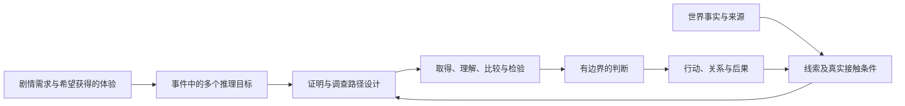

# 推理目标与判断边界

## 2. 基本对象与关系

**世界事实**：故事中实际发生或当前成立的状态，独立于玩家发现。**载体**：承载信息的物、身体、环境、记录、行为或人。**线索**：玩家在实际接触中可获得的信息片段，能够引出问题、改变某个判断、指向调查机会或支持行动。载体与线索不一一对应：一份信可以有几个信息片段，几个人也可能只重复同一来源。

**推理目标**：玩家需要或可以回答的明确问题及其可检验判断，如“伤害发生在操作之前还是之后”“甲是否得到乙的授权”。目标包含候选解释、判断范围、所需依据和剧情用途，不等于一句供KP知道的秘密。

**事件真相**：多个目标相接后，对该事件中发生什么、怎样发生、谁参与、影响谁及为什么的有边界解释。**剧情推动点**：一项认识或行动使机会、危险、关系、资源、立场或结果改变的接口。目标可以支持推动，也可以服务人物理解、情绪回收或可选探索，不强制所有认识立刻开门。

赋能设计、制作或审查先读[第6.3节](empowerment.md#src-inference-design-314)，分别写内容、体验和用途；情绪／求知可有其他价值，但未落实三类作用时不冒记赋能完成。

本方法维护三种关系：目标之间的证明依赖；调查节点之间的接触路径；目标与剧情后果之间的用途。三者共用ID，但分别画清。

### 2.1 玩家前置知识与推论规则的可用性

**推论规则**是从材料到判断所需的关系，例如某类操作会留下何种痕迹、某日期格式怎样理解、某种异常只在什么条件下发生。它可能来自常识、角色专业能力、先前体验或局内新查证。作者须登记它对当前目标的适用范围与玩家实际获得入口，不能因作者知道就视为玩家已有。

可沿现有目标卡登记：玩家/角色开局知道什么；哪个必要概念或规则尚未知；由谁通过观察、说明、示范或真实反馈提供；何时可获得；可靠范围和例外。角色有专业技能但玩家缺专业知识时，按所用规则把角色有资格判断的内容转为明确可用信息；可给有限专业解释，不替玩家串出超出专业范围的全部因果。玩家的现实专长也不能自动覆盖角色无法观察或获取的局内事实。

首次呈现须分清观察、来源说法和解释，让关键对象、时间、位置及比较字段能被辨认或有合法辨认入口。可以保留身份未知、模糊表象和需要解读的材料，但不能把作者内部ID当玩家理解，也不能将无提示的生僻知识设为唯一过关口。难度可来自联系、比较和检验；获得前置知识的过程本身也可设计为目标。

这是把学习与证据研究用于游戏制作的接口，不是要求玩家统一受训或进行知识考试。相关原资料及适用边界见[逻辑研究](../../scenario-writing/references/common/provenance.md#history-1a6d450d326b)。

## 3. 第一部分：从剧情需求构建推理目标

### 3.1 先确定事件需要带来什么

先写这个事件的剧情作用：它要引出危险、改变信任、纠正责任、打开调查方向、提供行动方法，还是使玩家面对取舍？再写玩家应该亲手完成哪次认知变化。没有这一步，目标会变成穷尽后台知识的题库。

先从当前采用的事件、人物与关系资料列出重要事实，检查经过与时序、参与行为、个人处境与经历、关系与知情，以及当前选择的前件和后果。重要性由遗漏会损失哪种理解、选择、情绪回收或运行依据判断，不以秘密数量衡量。每项事实注明处理去向：推理判断、有限直接获知、背景、运行条件、披露待制作或有意保留未知；去向可重叠，不能用“已覆盖”代替范围。实际观察、人物答复或文书已明示的，按来源范围记获知，陈述准确性和历史确认仍另核。

推理目标是玩家需要形成的判断，说明比较、排除、连接或检验什么。“救出伤者”“完成支线”“让人物认罪”是行动或剧情结果，不直接等于推理目标。人物事实可服务理解及情绪回收，不必都成为主谜底证据，也不为每项背景另建谜题。

从事件真实因果拆问题，可使用下列类别检查遗漏，按需要选取，不按数量凑齐：

| 目标类别 | 常见问题 | 不能自动连带证明 |
|---|---|---|
| 状态与身份 | 是什么，是否同一人／物，曾在何处 | 同身份不证行为或动机 |
| 时间与顺序 | 哪一步先发生，持续多久，是否同一次 | 时间邻近不证因果 |
| 行为与行动者 | 谁做了什么，实际做到哪一步 | 接触、能力、机会不等实施 |
| 因果与机制 | 什么产生什么，何种条件使它成立 | 相伴发生不等唯一原因 |
| 关系与协作 | 谁授权、依赖、知情、承诺、帮助或阻碍谁 | 关系不自动共享知识或同谋 |
| 目的与责任 | 为什么这样做，有无替代与明知，承担哪项责任 | 做了不等恶意；有动机不等做过 |
| 风险与操作 | 怎样识别危险、停止、返回或改变结果 | 知道历史不等掌握完整操作 |

关系目标尽量写为“甲在何时向乙承诺什么，乙是否据此行动”，不要只写“甲乙关系好”。行为、知情、选择和目的分别证明；道德评价和法律式归责不从单个事实自动推出。

### 3.2 决定哪些目标合并，哪些拆开

若两个问题依赖不同来源、能处于不同确定程度，或会产生不同选择，就应分开。若几个细节共用同一判断、无法提供独立体验或行动价值，则作为目标字段而非新目标。一个事件需要几个目标，取决于剧情承诺与因果复杂度，不预定三至五个。

例如“甲偷走东西并故意陷害乙”至少要分别看物件确曾被移动、甲实施搬移、是否具有盗取目的、另一次栽赃是谁实施；搬走物件者可能实际在保护它，而栽赃者另有其人。身份或一个脚印不替这组问题全作答。

### 3.3 为每个目标登记完成标准

填写明确问题、承接的事件／个人／关系事实及故事线、作者事实、候选解释、判定范围、需要说明的假设、最小充分信息组合、反驳或降级条件、不可推出的结论，以及具体剧情／游玩用途。区分：

- 能引起合理怀疑。
- 能使某解释较优，但仍有重要缺口。
- 能在声明前提与范围内作稳定判断。
- 已足以支持保护、暂停等行动，但尚不足定完整责任。

“足以采取行动”的门槛与“足以断定历史”的门槛不同；它们不能用一个解题进度条代替。行动风险越高，所需把握通常应另核，不能普遍规定百分比。

判定玩家可解时，把实际能取得的材料与第2.1节可用规则一起核；不能只凭作者完整后台作出推论。若必要规则未提供，登记缺口及入口；若规则本身可争议，先作为待核前提而非确定事实。

直接看见结果、读到记录或听到明确自承，先记录实际获知及来源范围；经对象对合、时序关联、候选比较或范围检验形成新的有界关系，才记相应推理完成。行动成果另记。明确知道还缺什么可以是进展，但未决不当已证实，推理回报也不要求玩家说服NPC或选择作者偏好的结局。

### 3.4 建立目标组合与剧情接口

使用AND／OR依赖记录：某结论需几个不同事实相接为AND；足以支持同一范围的不同组合为OR。OR每个分支都须独立满足同一目标的完成标准，不能仅因来源不同就视为充分替代；其中一条分支也可包含多个AND前件。同源转述可形成取得上的OR，但不自动成为证明上的独立AND。一个线索可服务多目标，必须检查累计效果，防单条普通线索意外交出全案。

最小充分组合（旧称最低充分集）是相对明确目标、前提与完成标准而言的充分组合：移去其中一个必要成员即不再足够。这里的最小是包含关系，不要求在不同方案中条数最少。可以存在多组，不要求所有桌使用同一组。它不是线索数量配额。知识规则、范围与来源资格也是组合的前提，删项检查时不能悄悄补入作者知识。

完整替代路径的短例：目标仅为“同一原稿在t1到t2之间离开展位”，在身份、时间和观察可信的声明范围内，`[(t1真在展位 AND t2同一原稿真在柜中 AND 对象/时序对合) OR (对搬移过程的可靠连续观察 AND 原稿身份核验 AND 起终位置/时序核验)]`。任一完整分支可支持同一位置变化；只剩“柜里有一份相似稿”或“有人说好像搬过”不构成充分分支。此例展示一个独立可能设计，不给调用任务新增目击者，也不证明谁搬或为何。

跨目标或跨故事线整合，注明实际成立的时间、身份、因果、知情等连接。共用命题不自动共用结论；仅为查阅并列的联系不强做成证明依赖。目标来源池只是候选检索，不是充分证明或集齐门票；关系的支持与阶段用途须落到本次具体信息，不从整条线索的编号继承。

事件整合条件采用“目标及它们的因果连接”，不采用“答对若干个”。证明演员、动作和时间后仍可能缺动作间的关联。需要整体理解时，注明是哪几个结论及哪条连接足够；其他背景可保未知。事件推动可先于全貌，例如怀疑有人阻救已足以安排保护。
